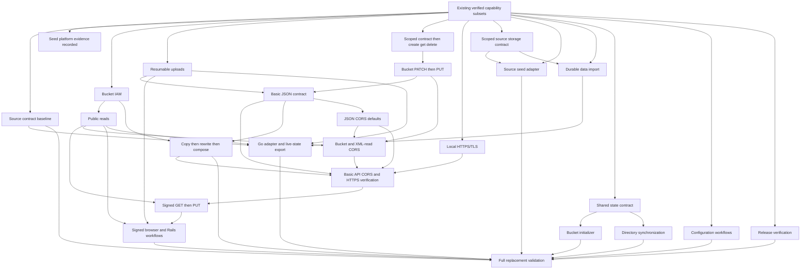

# Detailed delivery plan

<!-- markdownlint-configure-file {"MD013": {"tables": false}} -->

Start with the [roadmap](roadmap.md) for current priorities and user outcomes.
This reference retains detailed acceptance gates, evidence and dependencies.

## Delivery model

Complete a useful, independently verifiable capability before expanding its
scope. The execution plan is `delivery_plan` in
[`compatibility/features.json`](../../compatibility/features.json). It names
existing evidence, ordered deliverables, prerequisites, completion conditions
and exclusions. This document explains that plan; it owns no implementation
status.

## Parallel work and acceptance

The [roadmap](roadmap.md) now prioritizes starting from an image and preserving
existing workflows. Completed scopes below remain evidence, not work to repeat.
The ledger's order is a selection preference; only `depends_on` blocks a track.

| Priority | Track / owner | Work boundary | Actual prerequisite |
| --- | --- | --- | --- |
| First | Distribution | Release notes, workflow execution, registry access and consumer guide | Existing basic API/public-read gates and release policy |
| First | Configuration | CLI/env validation, advertised/public endpoints and host routing | Freeze each affected source configuration contract |
| Next | Shared state integration | Bucket identity, initialization authority, readiness and mutation interface | Existing runtime and bucket update behavior |
| Next | Bucket initializer | File parser and create-missing orchestration | Shared state contract and initialization schema |
| Next | Directory synchronization | Watch/rescan adapter and API write-back | Shared state contract and sync conflict/name/recovery design |
| Next | Seed and source import | Read-only source readers, manifests and preservation reports | Scoped source storage contract and existing ingestion |
| Then | Rails and reference coverage | Isolated client/protocol/profile slices | Their own ledger prerequisites; no blanket initializer/sync gate |
| Final gate | Release integration | All baseline capabilities, migration and named additions | Every required scope and public distribution evidence |

Distribution must not wait for Rails, initializer or sync completion. The current
workflow still requires its native release/platform gates before publishing an
image. Local images do not satisfy registry publication. Likewise, source-format
research, seed metadata and import readers do not wait for a watcher.

### Shared decisions before adapter implementation

Freeze bucket/project identity, strict initialization authority, startup ordering,
readiness after recovery and the shared bounded mutation/publication interface.
The initializer and watcher then work against that interface independently.
Full public-host configuration is not their prerequisite.

Assign shared catalog/schema/publication edits to one integration owner. Other
tracks own their adapters and tests and propose any shared changes through that
owner. This prevents competing schema edits or direct SQLite writes that bypass
conditions, checksums, generations, version history or crash recovery. Integrate
one small tested slice at a time, even when research and isolated adapters run
in parallel.

### Completion boundaries for missing work

**Configuration:** use the [19-variable inventory](fake-gcs-server-configuration.md)
and freeze listener, API advertised origin, public origin and Host routing
separately. Test host/peer/browser recipients, resumable Locations and final-host
signing. Implement remaining dual-listener, backend, event, location and logging
roles in separate slices; a renamed setting that does nothing is not support.

**Initializer:** select and version the file schema and CLI entry point before
coding. Validate the entire file, including duplicate names and unsupported
settings, before mutation. Create only missing buckets. Test two different CORS
and versioning configurations, API edits, repeated startup, removed entries and
interruption/retry without resetting existing settings or objects.

**Directory sync:** decide conflicts, portable names, metadata ownership and
synchronization delay before coding. Verify create/edit/delete/rename in both
directions, partial/editor writes, self-events, missed notifications, bounded
rescans and disk-full/interruption recovery. Preserve immutable generations and
report conflicts visibly. Watching files without coherent metadata is incomplete.

**Seed/import:** freeze `/data` versus runtime `/storage`, MIME rules, bucket
metadata and xattr/sidecar decoding in a scoped storage contract. Reader/manifest
work can proceed in parallel with the initializer and watcher. Import through a
bounded publication path into a separate destination. Block unsupported ACLs,
history or identities; a live-only subset must not claim lossless full migration.

**Reference breadth:** finish the complete source inventory, then split missing
ACL/metadata, JSON/XML/batch, helpers/events, Storage v1 gRPC, embedded Go and
backend workflows into independently tested slices. Existing HTTP SDK/browser
checks run throughout. Rails uses its already-delivered prerequisites and may
proceed early when an independent owner is available.

The [1.0.0 gate](release-policy.md#the-100-gate) combines the completed tracks.
Publish useful additions in separate `0.x` minors instead of bundling all tracks
into one version. No calendar dates or per-track version numbers are reserved.

The existing P0-P7 assignments remain coverage groups for inventory and
historical evidence. They are not whole-group execution gates. In particular,
P0 clock injection does not wait for lifecycle maintenance, and P1 single-request
upload does not wait for resumable transfer, signing or gRPC. Those extensions
have their own deliverables. Existing later work is retained even when an
earlier verification task remains open.

No feature status, fidelity, acceptance result, test ID or existing evidence
was changed to adopt this plan. A planning entry is neither an implementation
claim nor permission to start implementation.

The product's minimum functional target is the complete pinned reference
capability set, with gcs-mimic additions above it. For each affected feature,
inventory source-supported inputs, response information, configuration, state
effects and existing-client workflows before extending the native scope.
Source-equivalent functionality needs executable evidence; a narrower shared
happy path or extra strict validation does not establish a superset. Conflicting
legacy behavior belongs in an explicit compatibility profile, with native and
strict Google-contract behavior tested separately.

## Foundation gate

Before starting another capability, check the existing evidence for the
declared development profile and run only missing or affected checks:

- Build and start the pinned binary and supported source-built container.
- Validate configuration precedence, health/readiness and graceful shutdown.
- Recover persisted catalog/blob state before readiness and retain exclusive
  data-directory ownership.
- Use the injected clock, bounded transfer/catalog admission and indexed lookup.
- Pass ledger/generated-view and relevant Rust checks.

This gate concerns the runnable baseline. Local HTTPS/TLS and CORS are separate
required pre-signing deliverables below. Fixture extensions, maintenance state
machines, all-platform distribution and public publication also have their own
verification. These deliverables do not retroactively extend the
foundation's completion scope. Selected crash recovery is not power-loss proof.

## Existing capabilities and evidence

These entries show the declared verified scopes. Whole-feature completion is
recorded only in the ledger. Existing source versions, command outputs and limits
remain in the named evidence files.

| Capability | Verified scope | Remaining boundary | Evidence |
| --- | --- | --- | --- |
| Runtime foundation | HTTP, configuration, probes, non-root container and injected clock | Current-source platform/CI and release claims need their own evidence | [Runtime/container](evidence/distroless.md) |
| JSON bucket CRUD | Persistent create/get/list/delete, conditions and scoped paging | IAM/ACL, ownership and advanced settings | [Bucket verification](evidence/bucket-crud.md) |
| Bucket metadata PATCH | Label merge/removal, supported default class, versioning/default holds, atomic conditions, strict permission, restart and HTTP/Go/native/Docker checks | Whole method and affected broad behavior rows remain PARTIAL for advanced settings and provider edge parity | [Final PATCH verification](evidence/bucket-metadata-patch.md) |
| Bucket metadata PUT | Supplied-field replacement with omitted settings preserved locally; settings effects, atomic conditions, strict permission and resource preservation | Whole method remains PARTIAL; advanced fields, ACL/billing/projection and provider parity pending; reference/container/Docker evidence predates omission preservation | [Current PUT contract](slices/bucket-metadata-put.md), [historical integration verification](evidence/bucket-metadata-put.md) |
| Object media | Live-generation upload/read/delete, hashes and atomic conditions | Header/error parity, token replay and advanced semantics | [Media verification](evidence/object-media.md) |
| List and metadata | Prefix/delimiter/keyset paging; PATCH merge and PUT replacement | History, filters, full projection and legacy-input parity | [Integrated verification](evidence/object-list-metadata.md) |
| JSON multipart | Bounded metadata/media/checksum containers and Go single-request Writer | MIME edge parity, replay and advanced fields | [Multipart verification](evidence/multipart.md) |
| Local strict authentication | Local bearer/V4 RSA identities, project-plus-bucket roles and offline URL helpers | Other signing formats, full IAM/ACL and provider identity | [Authentication](evidence/strict-auth.md), [signed access](evidence/signed-urls.md) |
| Bucket IAM policies | Persistent unconditional predefined-role bindings, project-plus-bucket enforcement and atomic etags; native Go and strict Compose journey | Whole policy methods and inherited hierarchy remain PARTIAL; conditions, custom/basic roles, ACLs and wire parity remain | [Final IAM verification](evidence/bucket-iam.md) |
| Public and signed object transfers | Path-style and opt-in virtual-host XML GET/HEAD/PUT, V4 RSA signer permissions, response overrides, PAP, final-host binding, expiry/tamper rejection, bounded integrity checks, atomic conditions and actual trusted-HTTPS path-style Chromium signed transfers | Advanced XML/listing, ACL/UBLA transitions, other signing formats, provider error/header parity, Rails and virtual-host browsers | [Public reads](evidence/public-object-reads.md), [combined signed access](evidence/signed-urls.md), [signed browser verification](evidence/signed-browser.md) |
| JSON resumable upload | Sessions, bounded chunks/status/retry, atomic finalization, cancellation, fixed seven-day expiry, selected process-kill/restart recovery, client-reachable configured Location and normal pinned Go Writer; measured native large/slow/concurrent buffering | XML/signed initiation, token response replay, provider edge parity, power-loss durability and Linux/cgroup memory guarantees | [Final resumable verification](evidence/resumable-upload.md) |
| Single JSON range | Closed/open/suffix stored-byte reads, 206/416, pinned generation and bounded seeking | If-Range, transcoding and exact fallback/header parity | [Range verification](evidence/object-range.md) |
| Initial seed import | Import before readiness without replay; Linux invalid-byte rejection and read-only Compose persistence/reset | Manifest metadata, legacy defaults and source mutation protection remain outside the native contract | [Seed verification](evidence/seed-platform.md) |

`BEHAVIOR-OBJECT-016` remains IMPLEMENTED for its declared single-range subset;
`JSON-OBJECTS-005` remains PARTIAL. `UX-002` and `UX-009` are now IMPLEMENTED:
the missing Linux/Compose cases pass with recorded evidence. ARM64 uses native
execution and AMD64 uses emulation. Broader fixture/volume requirements retain
their explicit remaining scope. Range and seeding are existing work, not the
next features to reimplement. The integrated [native guide](evidence/seed-range-guide.txt)
and [Go SDK log](evidence/seed-range-sdk.txt) retain their actual execution scope.

## Earlier capability sequence

The completed scopes below explain how the runnable baseline was verified.
Current missing work is prioritized above. Validate each implementation step
before adding the next; an initiation route or success stub does not complete
a workflow. Whole-feature status remains in the ledger.

| Order | Deliverable | Completion boundary | Visible user outcome |
| ---: | --- | --- | --- |
| 1 | Seed platform verification | Linux filename and seeded Compose persistence/reset cases passed on 2026-10-22 | Missing platform evidence recorded; UX-002 and UX-009 IMPLEMENTED |
| 2 | Bucket IAM policies | Declared unconditional policy scope passed final Rust, Go, both Linux container architectures and full guide verification on 2026-10-22 | Delivered: policy operations affect access; DESIGN-014 and DESIGN-027 IMPLEMENTED, policy methods and hierarchy PARTIAL |
| 3 | Public object reads | Declared path-style XML GET/HEAD, allUsers versus registered-only grants and final Rust/SDK/container/guide checks passed on 2026-10-22 | Delivered: DESIGN-012, DESIGN-013, DESIGN-047 and UX-005 IMPLEMENTED; DESIGN-004 and broad XML methods PARTIAL; [final verification](evidence/public-object-reads.md) |
| 4 | Resumable upload | Declared initiation/chunk/status/retry/finalization/cancel/expiry/Location cases, normal pinned Go Writer, native buffering measurements and selected process-kill recovery passed on 2026-10-22 | Delivered: BEHAVIOR-OBJECT-010 through BEHAVIOR-OBJECT-014 and DESIGN-057 IMPLEMENTED; JSON-OBJECTS-007 and DESIGN-082 remain PARTIAL; [final verification](evidence/resumable-upload.md) |
| 5 | Bucket create, get and delete | Declared native/compatibility creation, basic GET, empty deletion, versioning/default holds and HTTP/SDK/container/guide checks passed on 2026-10-22; both pinned reference backends compared | Delivered: named baseline with explicit intentional/strict/unsupported differences; broad bucket and versioning/hold rows remain PARTIAL; [final verification](evidence/bucket-core-parity.md) |
| 6 | Bucket metadata PATCH | Declared label merge/removal, default class, versioning/default holds, conditions, strict permission and persistence passed final Rust/Go/container/guide checks on 2026-10-23; both pinned reference backends compared | Delivered: change basic settings without recreating the bucket; JSON-BUCKETS-008 and affected broad behavior rows remain PARTIAL; [final verification](evidence/bucket-metadata-patch.md) |
| 7 | Bucket metadata PUT | The original omission-reset policy passed integration checks on 2026-10-23; the revised local omission-preserving policy has Rust/Go/Ruby and native PUT guide evidence | Delivered: replace supplied modeled settings and preserve omitted settings; JSON-BUCKETS-013 remains PARTIAL; [current contract](slices/bucket-metadata-put.md) separates revised checks from [historical integration evidence](evidence/bucket-metadata-put.md) |
| 8 | Basic JSON contract | Frozen live-resource profile, documented single conditions/checksums/error envelopes, fields/read ETags and remaining-gap mapping passed final Rust/Go/reference/both-architecture containers and native/Docker guide checks on 2026-10-23 | Delivered: BEHAVIOR-COMMON-007/011 and BEHAVIOR-OBJECT-005 IMPLEMENTED in their declared scope; broad method rows remain PARTIAL; [final verification](evidence/basic-json-contract.md) |
| 9 | Object copy | Generation-pinned streaming, metadata, strict permissions, atomic conditions, holds/versioning, composites and restart pass the [final integrated gate](evidence/derived-objects.md) | Delivered: BEHAVIOR-OBJECT-023 IMPLEMENTED/EXACT; JSON-OBJECTS-003 remains PARTIAL for full ACL/owner projection |
| 10 | Object rewrite | One/multi-call progress, request-bound tokens, atomic destination, retry/restart and pinned Copier pass the [final integrated gate](evidence/derived-objects.md) | Delivered: BEHAVIOR-OBJECT-024 IMPLEMENTED/EXACT; JSON-OBJECTS-012 remains PARTIAL for full ACL/owner projection |
| 11 | Object compose | Ordered bounded sources, component/CRC32C metadata and atomic source deletion pass the [final integrated gate](evidence/derived-objects.md) | Delivered: JSON-OBJECTS-002 and BEHAVIOR-OBJECT-025/026/027 IMPLEMENTED/EXACT in the declared local scope |
| 12 | Local HTTPS/TLS | Built-in HTTPS default/explicit HTTP, optional supplied PEM pair, bounded handshake and trusted native/container/Go/Ruby/browser checks passed on 2026-10-23 | Delivered: DESIGN-065 IMPLEMENTED/PROJECT; DESIGN-055 gains HTTPS evidence and remains PARTIAL for proxy/signing; [final verification](evidence/local-tls.md) |
| 13 | JSON CORS defaults | Independent JSON defaults, actual-browser CRUD/uploads, exposed headers and strict denial pass the [CORS gate](evidence/cors.md) | Delivered: DESIGN-051 and DESIGN-053 IMPLEMENTED for the frozen scope |
| 14 | Bucket/XML CORS | Persistent configuration, validation/conditions/races, XML read/preflight rules, custom origins/default ports and browser restart pass the [CORS gate](evidence/cors.md) | Delivered: BEHAVIOR-BUCKET-009 and DESIGN-052 IMPLEMENTED; broad bucket methods remain PARTIAL |
| 15 | Basic API, CORS and HTTPS verification | Six bucket/nine object HTTP methods, pinned Go/Ruby, trusted HTTPS browser, Rust regressions and native/container journeys pass the [integrated gate](evidence/cors.md) | Delivered: UX-007 IMPLEMENTED for JSON browser transfers and XML reads; broader SDK/Rails and method parity remain explicit |
| 16 | V4 RSA signed download | Private GET/HEAD, final-host canonicalization, signer permission, expiry, tamper rejection and pinned Go/Ruby signers; integrated virtual-host and response override follow-ups; [combined evidence](evidence/signed-urls.md) | Delivered: DESIGN-030/032/033/034/036/038/045/048 IMPLEMENTED; DESIGN-035/044 and broad XML/auth rows remain PARTIAL for provider-exactness and advanced cases |
| 17 | V4 RSA signed upload | Bounded XML PUT, signed headers, streamed declared SHA256, atomic conditions/preservation, wire CORS, PAP and final Rust/SDK/container/native/Compose guide gate; [combined evidence](evidence/signed-urls.md) | Delivered: DESIGN-029, BEHAVIOR-BUCKET-014, DESIGN-022/023/025 and UX-006 IMPLEMENTED; bucket/parent policy fidelity stays LOCAL_SIMULATION where declared; DESIGN-037/055 and EXT-XML-022 remain PARTIAL for provider/proxy/advanced cases |
| 18 | Signed browser transfers | Delivered strict Chromium PUT/GET/HEAD over trusted HTTPS, unchanged signed endpoints, real preflight, exposed headers, CORS/permission/signature denials and restart; [final verification](evidence/signed-browser.md) | Delivered: BEHAVIOR-BUCKET-009, DESIGN-051/052/053 and UX-007 IMPLEMENTED for their scoped acceptance; provider/device boundaries remain explicit |

Order 10's declared local implementation is delivered in
[object rewrite evidence](evidence/object-rewrite.md): request-bound continuation,
atomic publication, immediate replay, strict grants, process-kill/corruption
recovery, fixed expiry, bounded sessions and pinned Go Copier. Its
integrated acceptance passed the [shared final gate](evidence/derived-objects.md),
closing the frozen behavior scope at IMPLEMENTED/EXACT.
Accepted full projection without ACL/owner semantics keeps
the broad method PARTIAL. Provider questions remain in SPEC-REWRITE-EDGES.

Order 8 is closed by the [final basic JSON evidence](evidence/basic-json-contract.md).
The [frozen live-resource contract](slices/basic-json-contract.md) maps completion
conditions 1, 3 and 4 to executed cases and explicit broad-method/gap destinations;
condition 2 retains its [fields/read-validator evidence](evidence/basic-json-fields-etag.md).
Documented single conditions, full-byte checksum validation and error envelopes
are IMPLEMENTED for their declared EXACT scopes. Mutation NotMatch status,
mixed/missing-resource precedence, multipart header and multi-request resumable
MD5 questions remain open; every original case, deviation and historical
verification is preserved. Broad API methods remain PARTIAL.
Order 9 **Object copy** has its [declared local implementation](slices/object-copy.md)
and [final evidence](evidence/object-copy.md). Its behavior row is IMPLEMENTED/EXACT;
the method remains PARTIAL for full ACL/owner projection.
Provider metadata/error/placement questions remain outside declared local acceptance.
Order 11 compose also passes the shared final gate. **Ruby/Rails workflows**
remain pending, extending the pinned Ruby SDK evidence to actual Active Storage
public/private delivery and direct browser uploads. Their dependencies are
already delivered; the new onboarding priority does not prevent parallel work.
Order 18's signed-browser scope is delivered in the
[final browser evidence](evidence/signed-browser.md): 61 signed-browser and 88
existing CORS checks pass, with nine hermetic signed CORS tests, HTTPS Go/Ruby,
both container architectures and affected native guide blocks. UX-007 is
IMPLEMENTED for the browser journey. The evidence also retains an unrelated
initial resumable-test transport race and its assertion-preserving correction.
Orders 16–17 are delivered in the
[combined signed-access evidence](evidence/signed-urls.md), with
[download](slices/signed-download.md) and [upload](slices/signed-upload.md) contracts.
Their integrated follow-ups add [response overrides](slices/xml-response-overrides.md),
[opt-in virtual hosts](slices/xml-virtual-host.md) and
[PAP](slices/public-access-prevention.md), including public-grant preservation and
signed transfers. The updated native and source-image/strict-Compose guides pass,
including PAP and restart. DESIGN-035 stays PARTIAL for duplicate and
ambiguous-query provider rules (SPEC-SIGNING-EDGES), with local
override extensions in SPEC-XML-RESPONSE-OVERRIDES. DESIGN-037 remains PARTIAL under
SPEC-SIGNED-PAYLOAD; DESIGN-044 retains exact errors/precedence under
SPEC-SIGNING-EDGES. DESIGN-055 still needs proxy-derived/separately configured
origins. Other signature formats, XML advanced methods and ACL/UBLA transitions
are not completed by this integration.
Orders 13–15 are closed by the
[CORS and basic API evidence](evidence/cors.md), including independent JSON/XML
behavior and mobile-origin research without a real-device/cloud claim. Order 12
**Local HTTPS/TLS** is delivered in the [final TLS evidence](evidence/local-tls.md),
including default HTTPS, explicit HTTP regression, CA/SAN/expiry failures,
bounded handshake/streaming deadlines, both container architectures, official
Go/Ruby clients and isolated Chromium trust without verification bypass.
Order 7 originally closed under the omission-reset policy with the
[historical PUT evidence](evidence/bucket-metadata-put.md), including Rust/Go,
reference, container and native/Docker guide checks with restart equality.
The [current PUT contract](slices/bucket-metadata-put.md) preserves omitted
settings as a local SDK compatibility choice and records Rust/Go/Ruby and native
PUT guide checks; reference/container/Docker checks were not rerun for that policy.
Separate maintenance adopted API client v0.308.0 with Storage v1.70.0 unchanged;
the full SDK suite passes and all 31 dependency inputs report CURRENT.
The complete buckets.update row stays PARTIAL for advanced fields,
ACL/billing/full projection and provider defaults/error parity.
Order 6 is closed by [final PATCH evidence](evidence/bucket-metadata-patch.md),
including effective versioning/default-hold changes, label merge/removal,
clock/revision behavior, native/Docker guide checks and explicit pinned-reference
differences. Advanced fields and Google-service questions remain pending.
Order 5 is closed by [final bucket evidence](evidence/bucket-core-parity.md),
including API-created settings that drive actual object effects, source-only
names across object/session/XML routes and both pinned reference backends.
Broader method/behavior rows retain their pending Google-contract cases; no
full replacement or whole-method parity is claimed.
Signed download depends explicitly on the
basic API, CORS and local HTTPS verification gate.
These are execution priorities, with no calendar delivery dates assigned.
The resumable deliverable is closed by [final evidence](evidence/resumable-upload.md),
including five native process-kill boundaries and their 20 repeated runs;
broader provider edge parity, other platforms and power loss remain unverified.
The scoped bucket IAM deliverable is closed by the
[final integration evidence](evidence/bucket-iam.md),
while the whole policy-method and hierarchy rows retain their explicit missing
cases. The preceding seed gate is closed by the
[Linux and Compose evidence](evidence/seed-platform.md). The committed
[public-read subset](slices/public-object-reads.md) serves path-style XML GET/HEAD
with persistent bucket grants; its final integrated verification is recorded in
[the public-read evidence](evidence/public-object-reads.md). This does not complete
the broader XML, authentication or access-control feature rows.

### Basic JSON API milestone before signed URLs

The milestone's fixed operation set is:

| Surface | Included methods | Supported basic scope |
| --- | --- | --- |
| Buckets | `insert`, `get`, `list`, `delete`, `patch`, `update` | Live buckets; modeled identity/metadata, project/prefix paging, labels and supported default storage class; atomic metageneration checks and strict local grants |
| Objects | `insert`, `get`, `list`, `delete`, `patch`, `update`, `copy`, `rewrite`, `compose` | Live objects; media/multipart/JSON-resumable upload, content/custom metadata, whole/single-range reads, prefix/delimiter/offset paging, checksums, source/destination conditions and bounded transfers |

The bucket core gate additionally covers the pinned source's supported
configuration and its interactions with these operations. Those required source
effects are not excluded merely because their historical group is P4. Keep
broader Google semantics and capabilities outside the selected source baseline
as separate pending work.

Local HTTPS/TLS, JSON CORS defaults and scoped bucket/XML-read CORS are also
required before signing. They add transport/browser acceptance scopes, not
additional API-method counts. Implement each as its own slice and validate the
combined behavior at the basic verification gate.

For HTTPS, supply a development certificate chain and private key, preserve
HTTP-only operation and add HTTPS-only operation. Validate configuration before
readiness and bound handshakes within connection admission. Test trusted local
CA/SAN fixtures with native, container, SDK and browser clients; untrusted CA,
wrong hostname, expiry, invalid key/configuration and stalled handshake cases
must fail safely. Keep listener and advertised endpoints distinct and verify
HTTPS resumable Locations. Do not disable client certificate verification or
claim HTTPS merely because generated URLs use that scheme. Public certificate
issuance, system trust-store changes, mTLS, hot reload and dual listeners remain
separate work.

JSON CORS uses the documented default response rules regardless of bucket CORS
configuration. XML CORS follows stored bucket origin/method/header/max-age rules.
Persist those rules through JSON bucket GET/PATCH/PUT with validation,
metageneration conditions and strict permission checks. Test actual cross-origin
JSON upload/read/list/update/delete and existing XML GET/HEAD, preflight and
exposed headers, denied object access after allowed preflight, and restart.
The [official CORS contract](https://docs.cloud.google.com/storage/docs/cross-origin)
defines the protocol distinction. XML bucket `?cors` configuration routes and
general XML writes remain outside this scoped delivery. A preflight success
does not prove an XML upload works; real signed PUT transfers are checked after
the XML-write/signing slice exists, in the later signed-browser gate.

The basic-contract deliverable now includes response `fields` selection over
supported resources and JSON read ETag validators, including policy GET and
combined query conditions. The two documented behavior scopes are IMPLEMENTED
with unchanged EXACT targets. Undocumented edges and provider wire questions
remain on named gaps and PARTIAL method rows. Copy, rewrite and
compose each have separate completion conditions, including failure preservation
and source/destination races. Rewrite must exercise continuation; an immediate
copy stub is insufficient. PATCH and PUT require distinct merge/replacement
tests, including omitted/null/default and immutable-field handling reconciled
against current sources before implementation.

If-Range is excluded from this milestone. The Google JSON contract remains
unestablished in `SPEC-RANGE-VALIDATORS` in the
[gap ledger](../../compatibility/gaps.json); retain the current explicit 501
rejection until authoritative sources establish it. Contract research and any
resulting implementation are separate later work and do not block basic JSON
completion, copy/rewrite/compose or signed URLs. The broad `objects.get` row
retains its pending cases and `PARTIAL` status.

Close the milestone only after linked HTTP evidence covers all six bucket and
nine object methods and pinned Go/Ruby workflows exercise the applicable calls.
Verify denied access, invalid input, stale conditions, checksum rejection,
paging, concurrent mutations and restart persistence. Use isolated local
endpoints; signed URLs and browser uploads are not prerequisites for basic SDK
coverage. Include trusted local HTTPS and actual-browser JSON/XML CORS checks.
Run final-source native/container journeys and relevant regressions;
unchanged evidence requires an explicit source/input comparison.

Excluded work beyond the selected source baseline remains visible on the broad
feature rows: additional history/protection semantics, soft delete/restore,
retention/lifecycle, glob/context filters, transcoding,
token-keyed response replay, object IAM/ACL, conditional IAM, full UBLA/PAP,
billing/encryption infrastructure and undocumented provider edge parity.
`objects.move`, bucket relocation/storage layout and the IAM/test-permission
methods retain their separate P2-P7 work. Signed URLs, signed-browser transfer
integration and full Rails direct uploads follow this milestone. Initial CORS
and local HTTPS implementation are prerequisites of this milestone.

This gate does not require whole-method `IMPLEMENTED` status and does not shrink
existing acceptance cases. It requires every case in the declared basic scope
to pass, with remaining broader cases explicitly pending. README comparison
checkmarks apply to the same named workflow for every product; whole-method
completion and fidelity remain solely in the feature ledger. Existing scoped
checkmarks may be corrected from existing evidence, without waiting for this
new milestone or claiming it has passed.

### Small steps inside the larger workflows

| Deliverable | Step order | Completion evidence |
| --- | --- | --- |
| Public reads | Policy get/set and enforcement; then grants and XML GET/HEAD | Wire permission/etag tests, restart, encoded paths and Go default/XML reads |
| Resumable upload | Initiation/status; then chunk/retry/finalization; then expiry/cancellation/recovery | Interrupted and duplicate chunks, atomic visibility, checksum rejection and pinned Go Writer |
| Basic APIs and transport | Bucket core source parity; bucket PATCH; bucket PUT; basic-contract gaps; copy; rewrite; compose; HTTPS; JSON CORS; bucket/XML CORS; integrated gate | Source-compatible bucket cases, explicit six-bucket/nine-object scope, trusted local TLS, browser/SDK/wire cases and final-source evidence before signing |
| CORS and HTTPS | Independent TLS, JSON defaults and bucket/XML-read slices precede signing; signed-browser behavior now has its separate executed evidence | Trusted-CA and negative certificate tests, real-browser preflight/access tests and persistent CORS configuration |
| Signed access | Signed GET first; XML PUT and signed PUT next | Valid, expired, tampered, wrong-host and insufficient-permission requests |
| Copy/rewrite/compose | Finish copy; then rewrite continuation; then compose | Source/destination races, token retry/restart, failed-overwrite preservation and bounded streaming |
| Ruby/Rails | Verify basic Ruby SDK calls before signing; finish later with the complete Rails/browser journey | Version-pinned SDK and real application/browser execution |

Resumable sessions are bearer capabilities with their own retry/status model.
They do not require signed URLs to exist. Generation conditions, accepted
invocation tokens and resumable offsets are not token-keyed response replay;
SPEC-013 remains open until that behavior is implemented and evidenced.

Before public grants, model the supported access restrictions and reject
recognized unsupported policy semantics rather than ignoring them. Full
ACL/default ACL, UBLA transitions, remaining PAP provider edges and conditional
IAM remain separate acceptance work; no public-read slice may bypass a
restriction it claims to support. Signed access must preserve the supported PAP
distinction between anonymous public grants and authorized signed requests.

## Migration track and prerequisites

The migration target preserves existing application workflows while extending
capabilities. Literal option spelling and configuration structure need not
match. The acceptance contract is [the migration contract](fake-gcs-server-migration.md);
its milestones live in `delivery_plan.migration`. They add no implementation status.

The migration track also requires bidirectional synchronization with an
inspectable bucket/object directory. Seed import and one-time conversion do not
satisfy it. The [filesystem investigation](fake-gcs-server-storage.md) records
the accepted requirement and open conflict/name-mapping decisions; implementation
remains pending under `delivery_plan.migration.filesystem_sync_contract`.

Before each capability slice, reconcile only its affected contracts and profile
conflicts. The complete source inventory is a full-replacement verification
prerequisite, not a prerequisite for bucket create/get/delete work. Keep it on
the migration track and add each missing capability as its own bounded slice.
The existing queue is an early useful release path; completing it alone does
not establish full replacement. No source surface disappears from the final
gate because it lacks a current GCS inventory row.

| Order | Migration deliverable | Prerequisite | Completion boundary |
| ---: | --- | --- | --- |
| 1 | Source contract baseline | Runtime foundation | Complete flags/routes/Go/backend inventory and executable legacy/strict expectations |
| 2 | Seed adapter | Scoped source storage contract and native seed | Preserve source keys, bytes, MIME/default metadata and selected seed lifecycle |
| 3 | Durable filesystem import | Scoped source storage contract, object media and metadata | Read xattrs/sidecars without modifying source; preserve identities and verify recovery |
| 4 | Go and live-state export | Baseline, durable import, public reads and resumable upload | Tested Go facade; export active/archived state before stopping memory source |
| 5 | Full replacement validation | Complete source inventory, migration, named additions, Rails and distribution | Every baseline capability and 1.0.0 condition passes; no undisclosed exclusions |

The diagram groups related prerequisites. It shows no execution results;
the ledger retains the exact dependencies and default selection order.

For settings, document equivalent uses through native `GCS_MIMIC_*` options;
identical flag names and suffixes are not required. The version-1 multi-bucket
initialization file creates missing buckets and preserves existing API settings
on restart. See the [initializer contract](slices/bucket-initialization.md);
broader shared-state crash injection remains pending. Seed input and persistent
destination remain separate. Existing
source-build Compose `GCS_MIMIC_PORT` publishes a host port; do not reinterpret
it as the container listener. See the
[configuration contract](fake-gcs-server-migration.md#configuration-compatibility-and-extensions).

## Completion and progress reporting

Each deliverable uses the ledger's common completion gate:

1. Freeze protocol/profile, supported fields, limits and exclusions; reconcile
   current official sources and affected gaps before implementation.
2. Name success, error, boundary, permission and feature-interaction cases.
3. Pass wire and applicable pinned SDK/CLI/container checks; verify relevant
   concurrency, interruption, restart, resource and clock properties.
4. Resolve deviations inside that scope and attach commands, results, test IDs
   and durable evidence. Retain explicit simulation/external boundaries.
5. Update the affected feature records and generated views. Apply the unchanged
   [IMPLEMENTED policy](compatibility-policy.md) to each whole feature row.

The existing acceptance references are navigation aids, not proof that every
new completion condition passes. Planning entries have no independent status.
At a delivery checkpoint, report the named completed scopes and their evidence
against a scope fixed before work started. State any scope change explicitly.
Do not derive a completion percentage merely from this planning metadata.

Report API operations, behavior and project requirements separately. Do not
count overlapping references as independent GCS features or assign PARTIAL a
50% weight. A broad method can remain PARTIAL while a narrow, independently
evidenced behavior is IMPLEMENTED. A later extension does not invalidate a
completed scope unless the existing behavior regresses.

README capability summaries should name the tested operation/profile and its
limits. Comparison marks must use the same named scope across products; they
must not be upgraded merely because the roadmap was reorganized.

## Coverage retained for later delivery

These group assignments remain unchanged in the feature ledger. The delivery
queue above takes precedence over their historical numeric ordering.

| Group | Remaining coverage |
| --- | --- |
| P0 Foundation | Maintenance extensions, dual listeners and outstanding native distribution/publication evidence |
| P1 Core data path | Advanced fields, transcoding and broader resource guarantees beyond the delivered basic updates/conditions |
| P2 Access and URLs | ACL/default ACL, UBLA transitions, PAP provider edges, conditional policies, HMAC/V2 and proxy endpoint breadth |
| P3 Transfer and HTTP breadth | HTTP batch, remaining XML/multipart, provider-exact edge behavior and extended SDKs beyond delivered rewrite continuations |
| P4 Protection and lifecycle | Versioning/hold provider interactions, soft delete/restore, retention, lifecycle and Autoclass |
| P5 Hierarchy and control | HNS/managed folders, inherited access, storage layout and shared LROs |
| P6 gRPC and Rapid | Storage v2 RPCs and appendable-object state machines |
| P7 Extended capabilities | Caches, analytics/jobs/events, contexts, infrastructure adapters and extended clients |

## First useful release

The first developer release retains the P1 core plus essential P2 public/private
and URL target: documented JSON workflows, the supported range/seed subsets,
strict local identity, effective scoped bucket IAM and public XML reads.
The basic milestone above, including Go/Ruby evidence, CORS and trusted local
HTTPS browser journeys, is a release verification prerequisite.
Rails remains a later capability; signed-browser behavior now has its
[executed gate and explicit provider/device boundaries](evidence/signed-browser.md).
The scoped JSON resumable workflow has
separate evidence. State supported profiles and resource, recovery and protocol
limits in the release; unverified clients remain explicit limitations.

Do not wait for lifecycle, gRPC, analytics or every row in P0/P1/P2 to complete.
Do require the release's declared feature/profile/platform tests, dependency
freshness, relevant resource measurements and the existing
[release policy](release-policy.md). Native/image workflow configuration is not
execution evidence. Publishing remains a separately authorized action.

## Source and storage maintenance

Retain the dated source lock, refresh Discovery/protobuf/release restrictions
before affected slices and releases, and keep new/retired methods visible.
No real-cloud differential test is implied; unresolved source questions remain
in `compatibility/gaps.json` until explicitly authorized evidence resolves them.

Keep SQLite plus opaque immutable files as the recommended durable default.
The storage comparison in `docs/en/storage-backends.md` evaluates BLOB,
key/value, filesystem and memory alternatives. Foreign-data migration is a
planned capability, separate from replacing the internal engine. Implement no
backend or importer in this documentation change. Reconsider the default after
a measured requirement justifies its recovery and compatibility cost.
