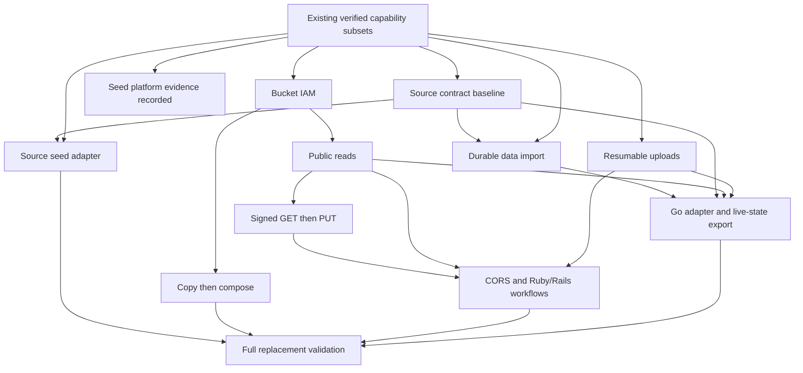

# Incremental implementation roadmap

<!-- markdownlint-configure-file {"MD013": {"tables": false}} -->

## Delivery model

Complete a useful, independently verifiable capability before expanding its
scope. The execution plan is `delivery_plan` in
[`compatibility/features.json`](../../compatibility/features.json). It names
existing evidence, ordered deliverables, prerequisites, completion conditions
and exclusions. This document explains that plan; it owns no implementation
status.

The existing P0-P7 assignments remain coverage groups for inventory and
historical evidence. They are not whole-group execution gates. In particular,
P0 clock injection does not wait for lifecycle maintenance, and P1 single-request
upload does not wait for resumable transfer, signing or gRPC. Those extensions
have their own deliverables. Existing later work is retained even when an
earlier verification task remains open.

No feature status, fidelity, acceptance result, test ID or existing evidence
was changed to adopt this plan. A planning entry is neither an implementation
claim nor permission to start implementation.

## Foundation gate

Before starting another capability, check the existing evidence for the
declared development profile and run only missing or affected checks:

- Build and start the pinned binary and supported source-built container.
- Validate configuration precedence, health/readiness and graceful shutdown.
- Recover persisted catalog/blob state before readiness and retain exclusive
  data-directory ownership.
- Use the injected clock, bounded transfer/catalog admission and indexed lookup.
- Pass ledger/generated-view and relevant Rust checks.

This gate concerns the runnable baseline. Optional TLS, fixture extensions,
maintenance state machines, all-platform distribution and public publication
are separately verified deliverables. They do not retroactively extend the
foundation's completion scope. Selected crash recovery is not power-loss proof.

## Existing capabilities and evidence

These entries show the declared verified scopes. Whole-feature completion is
recorded only in the ledger. Existing source versions, command outputs and limits
remain in the named evidence files.

| Capability | Verified scope | Remaining boundary | Evidence |
| --- | --- | --- | --- |
| Runtime foundation | HTTP, configuration, probes, non-root container and injected clock | Current-source platform/CI and release claims need their own evidence | [Runtime/container](evidence/distroless.md) |
| JSON bucket CRUD | Persistent create/get/list/delete, conditions and scoped paging | IAM/ACL, ownership and advanced settings | [Bucket verification](evidence/bucket-crud.md) |
| Object media | Live-generation upload/read/delete, hashes and atomic conditions | Header/error parity, token replay and advanced semantics | [Media verification](evidence/object-media.md) |
| List and metadata | Prefix/delimiter/keyset paging; PATCH merge and PUT replacement | History, filters, full projection and legacy-input parity | [Integrated verification](evidence/object-list-metadata.md) |
| JSON multipart | Bounded metadata/media/checksum containers and Go single-request Writer | MIME edge parity, replay and advanced fields | [Multipart verification](evidence/multipart.md) |
| Local strict authentication | Local tokens, project-level predefined roles and pure URL builder | Signatures and full strict behavior | [Authentication verification](evidence/strict-auth.md) |
| Bucket IAM policies | Persistent unconditional predefined-role bindings, project-plus-bucket enforcement and atomic etags; native Go and strict Compose journey | Whole policy methods and inherited hierarchy remain PARTIAL; conditions, custom/basic roles, ACLs and wire parity remain | [Final IAM verification](evidence/bucket-iam.md) |
| Public object reads | Delivered in committed code: path-style XML GET/HEAD, live-generation selection, single ranges, match conditions, public/registered-only grants and revocation | Virtual-host routing, XML writes/listing, ACL/UBLA/PAP state machines and signatures; final integration evidence pending | [Public-read verification](evidence/public-object-reads.md) |
| Single JSON range | Closed/open/suffix stored-byte reads, 206/416, pinned generation and bounded seeking | If-Range, transcoding and exact fallback/header parity | [Range verification](evidence/object-range.md) |
| Initial seed import | Import before readiness without replay; Linux invalid-byte rejection and read-only Compose persistence/reset | Manifest metadata, legacy defaults and source mutation protection remain outside the native contract | [Seed verification](evidence/seed-platform.md) |

`BEHAVIOR-OBJECT-016` remains IMPLEMENTED for its declared single-range subset;
`JSON-OBJECTS-005` remains PARTIAL. `UX-002` and `UX-009` are now IMPLEMENTED:
the missing Linux/Compose cases pass with recorded evidence. ARM64 uses native
execution and AMD64 uses emulation. Broader fixture/volume requirements retain
their explicit remaining scope. Range and seeding are existing work, not the
next features to reimplement. The integrated [native guide](evidence/seed-range-guide.txt)
and [Go SDK log](evidence/seed-range-sdk.txt) retain their actual execution scope.

## Ordered delivery queue

The order below is the default selection order. Explicit prerequisites in the
ledger determine readiness; independent verification or Ruby integration may
run earlier. Finish one bounded slice per implementation turn. Within a
deliverable, validate each step before adding the next; an initiation route or
success stub does not complete a workflow.

| Order | Deliverable | Completion boundary | Visible user outcome |
| ---: | --- | --- | --- |
| 1 | Seed platform verification | Linux filename and seeded Compose persistence/reset cases passed on 2026-10-22 | Missing platform evidence recorded; UX-002 and UX-009 IMPLEMENTED |
| 2 | Bucket IAM policies | Declared unconditional policy scope passed final Rust, Go, both Linux container architectures and full guide verification on 2026-10-22 | Delivered: policy operations affect access; DESIGN-014 and DESIGN-027 IMPLEMENTED, policy methods and hierarchy PARTIAL |
| 3 | Public object reads | Committed path-style XML GET/HEAD and allUsers versus registered-only grants; final Rust/SDK/container/guide evidence pending | Delivered: public URLs return bytes and private URLs enforce access; [final verification](evidence/public-object-reads.md) pending |
| 4 | Resumable upload | Initiation, chunks, status/retry, finalization, cancellation/expiry and pinned Go Writer | Normal chunked SDK uploads work |
| 5 | V4 RSA signed download | Final-host canonicalization, signer permission, expiry and tamper rejection | Private objects can be downloaded with validated signed GET |
| 6 | V4 RSA signed upload | Bounded XML PUT, signed headers/payload rules, atomic conditions and failure preservation | Validated signed PUT works |
| 7 | Object copy | Generation-pinned source, metadata rules, permissions and atomic destination conditions | Copy an object without a client download/upload |
| 8 | Object compose | Ordered bounded sources, component/checksum rules and explicit source-deletion semantics | Concatenate objects into one destination |
| 9 | Browser CORS | JSON/XML distinction and real-browser positive/negative/preflight checks | Browser upload/download works under the declared origins |
| 10 | Ruby/Rails workflows | Pinned Ruby operations and actual Active Storage public/private delivery plus direct uploads | Tested application integration |
| 11 | Release verification | Required CI/native targets, freshness, notices, checksums and explicitly authorized publication | Reproducible downloadable artifacts |

The next implementation capability is **resumable upload** (order 4).
The scoped bucket IAM deliverable is closed by the
[final integration evidence](evidence/bucket-iam.md),
while the whole policy-method and hierarchy rows retain their explicit missing
cases. The preceding seed gate is closed by the
[Linux and Compose evidence](evidence/seed-platform.md). The committed
[public-read subset](slices/public-object-reads.md) serves path-style XML GET/HEAD
with persistent bucket grants; its final integrated verification belongs in
[the public-read evidence](evidence/public-object-reads.md). This does not complete
the broader XML, authentication or access-control feature rows.

### Small steps inside the larger workflows

| Deliverable | Step order | Completion evidence |
| --- | --- | --- |
| Public reads | Policy get/set and enforcement; then grants and XML GET/HEAD | Wire permission/etag tests, restart, encoded paths and Go default/XML reads |
| Resumable upload | Initiation/status; then chunk/retry/finalization; then expiry/cancellation/recovery | Interrupted and duplicate chunks, atomic visibility, checksum rejection and pinned Go Writer |
| Signed access | Signed GET first; XML PUT and signed PUT next | Valid, expired, tampered, wrong-host and insufficient-permission requests |
| Copy/compose | Finish copy; then implement compose | Source/destination races, failed-overwrite preservation and bounded streaming |
| Ruby/Rails | Add applicable Ruby cases as capabilities land; finish with the complete Rails/browser journey | Version-pinned SDK and real application/browser execution |

Resumable sessions are bearer capabilities with their own retry/status model.
They do not require signed URLs to exist. Generation conditions, accepted
invocation tokens and resumable offsets are not token-keyed response replay;
SPEC-013 remains open until that behavior is implemented and evidenced.

Before public grants, model the supported access restrictions and reject
recognized unsupported policy semantics rather than ignoring them. Full
ACL/default ACL, UBLA/PAP transitions and conditional IAM remain separate
acceptance work; no public-read slice may bypass a restriction it claims to
support. Signed access must preserve the supported PAP distinction between
anonymous public grants and authorized signed requests.

## Migration track and prerequisites

The product target is a complete fake-gcs-server behavioral superset after
renaming environment keys and explicit data conversion. The acceptance contract
is [the migration contract](fake-gcs-server-migration.md); its milestones live in
`delivery_plan.migration`. They add no implementation status.

Before affected capability slices, inventory source behavior and profile
conflicts. Add each missing source capability as its own bounded slice.
The existing queue is an early useful release path; completing it alone does
not establish full replacement. No source surface disappears from the final
gate because it lacks a current GCS inventory row.

| Order | Migration deliverable | Prerequisite | Completion boundary |
| ---: | --- | --- | --- |
| 1 | Source contract baseline | Runtime foundation | Complete flags/routes/Go/backend inventory and executable legacy/strict expectations |
| 2 | Seed adapter | Baseline and native seed | Preserve source keys, bytes, MIME/default metadata and selected seed lifecycle |
| 3 | Durable filesystem import | Baseline, object media and metadata | Read xattrs/sidecars without modifying source; preserve identities and verify recovery |
| 4 | Go and live-state export | Baseline, durable import, public reads and resumable upload | Tested Go facade; export active/archived state before stopping memory source |
| 5 | Full replacement validation | Seed adapter, Go/live-state, compose and Ruby/Rails | Every baseline capability and preservation case passes; no undisclosed exclusions |

The diagram groups related prerequisites. It shows no execution results;
the ledger retains the exact dependencies and default selection order.

For settings, replace `FAKE_GCS_` with `GCS_MIMIC_` and retain suffix/value
semantics; legacy keys produce a rename diagnostic, never aliases or fallback.
Seed input and persistent destination remain separate. Existing Compose
`GCS_MIMIC_PORT` publishes a host port; do not silently reinterpret it as the
container listener. Equivalent settings, importers and compatibility profiles
have not been implemented.

## Completion and progress reporting

Each deliverable uses the ledger's common completion gate:

1. Freeze protocol/profile, supported fields, limits and exclusions; reconcile
   current official sources and affected gaps before implementation.
2. Name success, error, boundary, permission and feature-interaction cases.
3. Pass wire and applicable pinned SDK/CLI/container checks; verify relevant
   concurrency, interruption, restart, resource and clock properties.
4. Resolve deviations inside that scope and attach commands, results, test IDs
   and durable evidence. Retain explicit simulation/external boundaries.
5. Update the affected feature records and generated views. Apply the unchanged
   [IMPLEMENTED policy](compatibility-policy.md) to each whole feature row.

The existing acceptance references are navigation aids, not proof that every
new completion condition passes. Planning entries have no independent status.
At a delivery checkpoint, report the named completed scopes and their evidence
against a scope fixed before work started. State any scope change explicitly.
Do not derive a completion percentage merely from this planning metadata.

Report API operations, behavior and project requirements separately. Do not
count overlapping references as independent GCS features or assign PARTIAL a
50% weight. A broad method can remain PARTIAL while a narrow, independently
evidenced behavior is IMPLEMENTED. A later extension does not invalidate a
completed scope unless the existing behavior regresses.

README capability summaries should name the tested operation/profile and its
limits. Comparison marks must use the same named scope across products; they
must not be upgraded merely because the roadmap was reorganized.

## Coverage retained for later delivery

These group assignments remain unchanged in the feature ledger. The delivery
queue above takes precedence over their historical numeric ordering.

| Group | Remaining coverage |
| --- | --- |
| P0 Foundation | TLS, maintenance extensions, platform/CI and distribution evidence |
| P1 Core data path | Broader bucket updates, fields, HTTP conditions, transcoding and resource measurements |
| P2 Access and URLs | Remaining ACL/default ACL, UBLA/PAP, conditional policies, HMAC/V2 and endpoint breadth |
| P3 Transfer and HTTP breadth | Rewrite continuations, HTTP batch, remaining XML/multipart and extended SDKs |
| P4 Protection and lifecycle | Versioning, soft delete/restore, holds, retention, lifecycle and Autoclass |
| P5 Hierarchy and control | HNS/managed folders, inherited access, storage layout and shared LROs |
| P6 gRPC and Rapid | Storage v2 RPCs and appendable-object state machines |
| P7 Extended capabilities | Caches, analytics/jobs/events, contexts, infrastructure adapters and extended clients |

## First useful release

The first developer release retains the P1 core plus essential P2 public/private
and URL target: documented JSON workflows, the supported range/seed subsets,
strict local identity, effective scoped bucket IAM and public XML reads.
Include applicable Go and Ruby evidence; any unverified client remains an
explicit limitation. Signed URLs and resumable uploads can follow as separate
capabilities; the release must state its single-request upload limitations.

Do not wait for lifecycle, gRPC, analytics or every row in P0/P1/P2 to complete.
Do require the release's declared feature/profile/platform tests, dependency
freshness, relevant resource measurements and the existing
[release policy](release-policy.md). Native/image workflow configuration is not
execution evidence. Publishing remains a separately authorized action.

## Source and storage maintenance

Retain the dated source lock, refresh Discovery/protobuf/release restrictions
before affected slices and releases, and keep new/retired methods visible.
No real-cloud differential test is implied; unresolved source questions remain
in `compatibility/gaps.json` until explicitly authorized evidence resolves them.

Keep SQLite plus opaque immutable files as the recommended durable default.
The storage comparison in `docs/en/storage-backends.md` evaluates BLOB,
key/value, filesystem and memory alternatives. Foreign-data migration is a
planned capability, separate from replacing the internal engine. Implement no
backend or importer in this documentation change. Reconsider the default after
a measured requirement justifies its recovery and compatibility cost.
