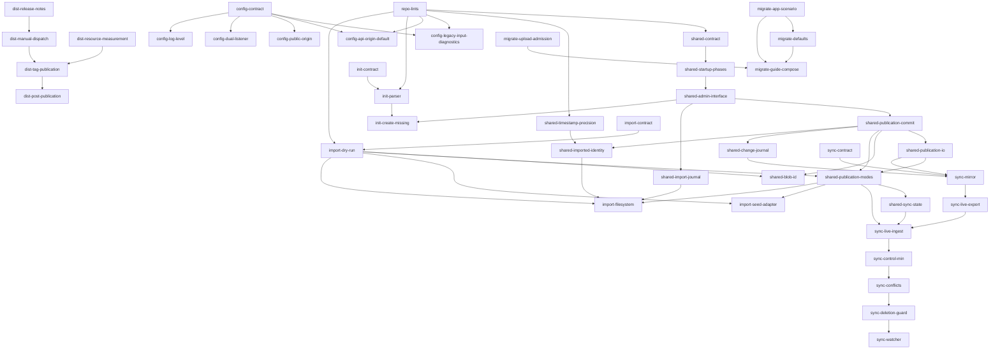
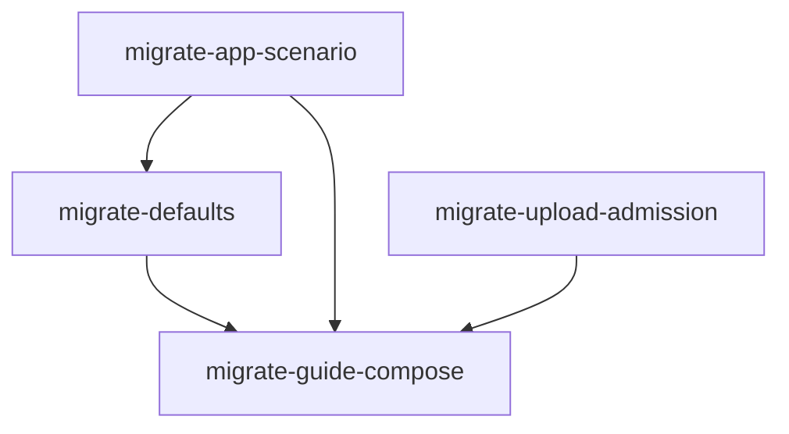

# 導入・移行トラックの実装計画

<!-- markdownlint-configure-file {"MD013": false, "MD024": {"siblings_only": true}} -->

2026-10-24 作成。対象は [detailed delivery plan](../docs/en/delivery-plan.md#parallel-work-and-acceptance) の
「Parallel work and acceptance」表のうち First / Next の 6 トラックと、2026-10-25 に実利用アプリの調査から足した
fake-gcs-server からの移行トラック（第 9 節）です。

実装状態の正本は [`compatibility/features.json`](../compatibility/features.json) です。この計画は状態・fidelity・証跡を
変更しません。調査の詳細とコードの根拠は [調査メモ](onboarding-tracks-findings.ja.md) にあります。

## この計画の読み方

- 担当者は **第 1 節** と **自分のトラックの節** だけ読めば着手できるようにしています。各トラックの最初にある
  「着手前チェック」で、完了しているべきスライスと、ほかの節で読むべき箇所を挙げています。
- 各トラックの決まりごとは 3 種類に分けています。

| 見出し | 意味 |
| --- | --- |
| 決定 | オーナーが確定した事項。変える場合はオーナーに確認する |
| 設計の要件 | 決定と台帳の契約から導いた、実装で守る条件。変える場合は理由を契約文書に書く |
| 未決 | スライスの契約文書で決める事項。推奨案があれば添えている |

- スライスは名前（例: `shared-startup-phases`）で呼びます。依存図と依頼テンプレートも同じ名前を使います。

## 1. 全トラック共通のルール

`AGENTS.md` とそこに列挙された必読文書を読んだうえで、次を守ってください。

- **台帳が唯一の状態ソース**: スライスの完了時に対象の機能行を更新し、`cargo xtask compatibility render` で英語・日本語の
  機能表を再生成する。`delivery_plan` の計画エントリには状態を持たせない。
- **受け入れケースを先に書く**: 正常系・異常系・境界・権限・相互作用を、実装前に台帳と slice 文書へ書く。
  PARTIAL / IMPLEMENTED は [compatibility policy](../docs/en/compatibility-policy.md) に従う。
- **効果のない設定を受け付けない**: 名前を受け付けるだけの設定は対応済みと数えない。
- **共有カタログは統合オーナーだけが変更する**: `src/storage/`（カタログ・スキーマ・公開経路）と `src/main.rs` の
  起動順序は Shared state の担当者が変更する。ほかのトラックは新しいモジュールとテストを持ち、共有部分の変更は依頼する。
  SQLite への直接書き込みや、条件・ハッシュ・世代の迂回は禁止。
- **バックグラウンド処理は API の受付枠を使わない**: カタログ呼び出し（同時 32 件）は、アップロードの事前確認とresumableの作成・読込・checkpointが空きを待ち、
  ほかの呼び出しは空きがなければ即失敗する。API のアップロードに専用の本数枠はなく、既存の `max_connections`（既定 32）が
  同時に動く接続数を制限し、超えた接続は待つ。停止時は実行中のアップロードと後始末の完了を通知で待つ。
  SQLite の実行は直列。同期・取り込みは管理インターフェース（第 5 節）を使う。
- **`data_dir` の `staging/` と `blobs/` に独自のファイルを置かない**: 起動時の復旧が、参照されていないものを消し、
  想定外のエントリでは起動を止める。
- **診断は直し方まで出す**（Configuration・Initializer・Sync 共通）: 問題は 1 件ずつではなく全件まとめて出す。
  各行は「元のキー・フィールド → 直し方（値の例を含む）」の形にする。具体的な書式は `config-contract` で決め、
  ほかのトラックもそれに合わせる。
- **外部に影響する操作は都度オーナーの許可を取る**: workflow の手動実行、タグ push、GitHub Release、GHCR への push、
  パッケージ公開設定の変更。設定済みの workflow は実行の証拠にならない。
- **言語とコミット**: コード・コメント・コミット・`docs/en` は英語、`docs/ja` は同じ機能 ID と状態で追従する。
  英語の Conventional Commits、機能単位、`git add` はパスを列挙する。
- **リポジトリに残さないもの**: セッション内でしか意味を持たない番号、ローカル環境の絶対パス。コミット前に
  `git grep -nE '/Users/|/private/|/var/folders|/tmp/|/home/[a-z]'` で確認する。

### 共通部品（同じ処理を 2 か所に書かない）

次の処理は、今すでに重複しているか、複数のトラックが同じものを必要とします。最初に必要になったスライスが共通部品として作り、
既存の重複もそのスライスで置き換えます。2 番目以降のトラックはそれを使います。機能として違う部分（下表の「違ってよい部分」）は
共通化しません。根拠は [調査メモ 第 8 節](onboarding-tracks-findings.ja.md#8-共通化の候補)。

| 共通部品 | 今の重複 | 使うトラック | 作るスライス | 違ってよい部分 |
| --- | --- | --- | --- | --- |
| 公開の確定（世代の割り当て・前の世代の退避・INSERT・blob 回収） | `objects.rs`、`derived.rs`、`resumable_transfer.rs` の 3 か所 | Shared state、Sync、Import | `shared-publication-commit` | 呼び出し元ごとの事前検証（copy の元オブジェクトの確認、resumable のセッション状態） |
| MD5・CRC32C のストリーミング計算（途中状態を保存できる形）。`src/storage/` の外の純粋なモジュール（例: `src/hashing.rs`） | `objects.rs` の `write_body`、`derived.rs` の 2 か所、`resumable_transfer.rs` | Import、Shared state、Sync | `import-dry-run` が `src/hashing.rs` を作る。既存の 4 か所の載せ替えは `shared-blob-id` で行う（`import-dry-run` の完了を待つ） | 途中状態を保存するか（derived は保存し、resumable は確定時に全体を読み直す） |
| 原子的なファイル置換（一時ファイル → `sync_all` → rename → 親ディレクトリの fsync。Windows は `MoveFileExW` の `WRITE_THROUGH`）と、OS 固有の呼び出し（`renameat2` の入れ替え、ファイル記述子からのコピー、ナノ秒の ctime）。`src/storage/` の外の 1 モジュール（例: `src/fsutil.rs`）にまとめ、unsafe はここだけに置く | `objects.rs` の `publish_blob`・`sync_dir`（`pub(super)` で外から使えない） | Shared state、Sync | `shared-publication-io`（置換・クローン・コピーをまとめて作る。関数の形は `shared-contract` で決める）。`shared-publication-modes` と `sync-mirror` はそれを使う | 置換先がシャードの中か作業ツリーか |
| パスの重なりの検査（`canonicalize` してから、どちらかがもう一方の接頭辞かを見る） | `seed.rs`（`seed_dir` と `data_dir`） | Sync（`sync_dir`）、Import（ソースと宛先） | `import-dry-run` | 対象の組み合わせ |
| 待機付きで上限時間のある同時実行枠 | なし（既存の枠はすべて `try_acquire` で即失敗） | Shared state（管理用のアップロード枠）、Sync（ファイル操作の枠、`sync wait`） | `shared-admin-interface` | 枠の数と上限時間 |
| 上限付きのファイル読み込み（`take(上限 + 1)` で超過を検出） | `config.rs`（64 KiB）、`auth/mod.rs`（64 KiB）、`tls.rs`（1 MiB）、`main.rs` の秘密鍵（16 KiB） | Configuration、Initializer | `init-parser` | 上限値と、超過時のメッセージ |
| 基底 URL の検証と正規化 | `config.rs` の `api_base_url` と `url::normalize_base_url` が同じ検査を別々に持つ | Configuration | `config-public-origin` | 設定名を含むエラーメッセージ |
| 16 進数への変換 | `objects.rs`（blob ID）、`derived.rs`、`rewrite_token.rs` が 1 バイトごとに `format!` | Import、Shared state | `import-dry-run` が `crate::hashing::encode_lower` を作成済み。`shared-blob-id` が `BlobId` と既存箇所の載せ替えを担当 | なし |
| event と診断の出力（JSON の event、レベル、全件まとめた診断） | `main.rs`、`seed.rs` の手書きの JSON と、約 25 か所の自由書式の `eprintln!` | Configuration、Initializer、Sync、Import | `config-legacy-input-diagnostics`（最小限）→ `config-log-level`（レベル） | 各 event の項目 |
| 上限付きのディレクトリのイテレーター（件数と深さの上限、整列、専用スレッドで動かす）と、無視するファイルの判定関数（OS のメタデータ `.DS_Store`・`._*` と、同期のエディタの一時ファイル。取り込み側の無視と、書き出し側の「表現不可」の両方で同じ関数を使う） | `seed.rs` の走査、`objects.rs` の `os_metadata`（seed はこの判定を使っていない） | seed、Sync、Import | `import-dry-run` | **走査の方針はそれぞれ別に持つ**: seed は失敗で閉じる 1 回きり、Sync は stat の差分による増分と無視パターン・大文字小文字の衝突の判定、Import はサイドカーと `.bucketMetadata` の除外と `PathUnescape` |
| ファイルパスとオブジェクト名の対応（表現できるかの判定を含む） | `seed.rs` がパスの要素を `/` で結合して検証 | Sync、seed、Import | `sync-contract` で規則を決め、最初に使うスライスで作る | 上流の永続形式のバケット名の `PathEscape` は、その形式の読み取り側に置く |
| 拡張子から MIME を決める表 | まだない | Import（seed）、Sync（新しいファイル） | `import-seed-adapter` | 使うかどうかの設定 |
| TLS コネクターと CA の読み込み | `main.rs` の `healthcheck` と `tls.rs` | Sync（`gcs-mimic sync`） | `sync-control-min` | **HTTP クライアントは共通にしない**: `healthcheck` は 2 秒ごとに走る GET だけの最小実装（2 秒・16 KiB の上限）のまま残し、`sync` の CLI は POST・長い待機・strict の認証を持つ別のクライアントにする |
| 名前からの既定バケットの作成 | `seed.rs` が `{"name": ...}` を組み立てて検証 | Initializer、Sync（新しいディレクトリ）、seed | `shared-admin-interface`（`ensure_bucket` と並べる） | 所有プロジェクトの決め方 |
| ローカルのファイルからの公開（専用スレッドでのクローンかコピー、ハッシュ 1 回、確定処理への受け渡し） | まだない（seed は `mpsc` で `put_object` に流している） | seed、Sync（取り込み）、Import | `shared-publication-modes`（`publish_from_file`） | 確定時のモード（`Replace`・`InheritFromReplaced`・`SkipIfSameHash`） |

### パフォーマンスと堅牢性

すべてのトラックで、次を実装の前提にします。性能の主張は実測に基づき、測っていない数値を書かないこと（`AGENTS.md`）。

#### 実行の資源

- **バックグラウンドの走査と取り込みは共有のブロッキング用プールに入れない**。`max_blocking_threads` の既定は 2 本で、SQLite の
  全処理、チャンクごとの `tokio::fs`、blob の公開がこれを共有している。`tokio::fs` で 1 ファイルずつ stat すると、ファイル数と
  同じ回数の `spawn_blocking` が起きる。同期と取り込みの走査・本文の読み込み・ハッシュ計算は、専用の OS スレッドで同期処理の
  イテレーターとして動かし、上限付きの `mpsc` でページ単位（例: 256 件）に async 側へ渡す。
- **ローカルのファイルの公開は `publish_from_file` を使う**。ネットワークの本文向けの経路（`mpsc` → `write_body`）を通すと、書き込みが
  共有のプールを奪い合い、ハッシュも 2 回計算する。方式は第 5 節の管理インターフェースの表にある。
- **SQLite は 1 接続で直列**。バックグラウンド処理の 1 回のトランザクションは短く、ページ単位（`list_objects` と同じ keyset）にし、
  API の処理と交互に実行されるようにする。
- **fsync は必要な分だけ、まとめて行う**。公開経路の fsync の削減と、複数件をまとめて確定する方法は第 5 節（`shared-publication-io`、
  `publish_objects`）にある。どの変更も、kill からの復旧テストで迂回がないことを確かめる。
- **変更ジャーナルは読み手がいるときだけ書く**。同期もイベントも使わない利用者に書き込みのコストを払わせない。
- **起動時の復旧の O(N) は、今の形を変えない**。今の `objects::recover` は件数に比例する処理を bind 前に行うが、想定規模では
  問題にならない（1 万件で約 0.1 秒の実測がある）。参照されていない blob の掃除を
  ready の後に移すと確定前の blob を消すので、移す場合は第 5 節の「公開中の blob の保護」に従う。それまでは今の形を変えない。

#### I/O とメモリ

- **本文は 1 回だけ読み、コピーしない**。ハッシュは本文を流しながら計算し、読み直さない。本文は `BytesMut` に読んで `freeze` して
  渡し、`Bytes::copy_from_slice` で写すのは、上限を超える大きなフレームを分割するときだけにする（今の seed は毎回コピーしている）。
- **同期の再走査は stat で絞る**。（サイズ、ナノ秒の mtime と ctime、inode）を同期状態と比べ、変わったファイルだけ本文を読む。
  ただし mtime がファイルシステムの粒度の範囲で記録時刻と重なるファイルは「racy」とし、次の再走査でハッシュを確かめる
  （同じ時刻の中の編集を見落とさないため。git の racy clean と同じ考え方）。
- **コピーは OS の仕組みに任せるが、使い分ける**。不変の blob からの書き戻しは、`ObjectReader` が開いた blob のファイル記述子から
  クローンか `copy_file_range` を使う（blob のパスはアダプターに渡さない）。書き換えられうるソースからの取り込みでは、
  `copy_file_range` を使わない（ハッシュと中身が別の時点のものになるため。第 5 節の `publish_from_file`）。
- **メモリは件数に比例させない**。一覧・再走査・取り込み・診断の集計は、上限付きのページか件数の上限を持つ。
- **起動を遅くしない**。bind 前の処理は上限のあるものだけ（第 5 節の readiness）。多数のバケットの作成は 1 つのトランザクションにまとめる。
- **処理がないときは何もしない**。ポーリングや空回りのタイマーを置かない。

#### 堅牢性

- **中断しても再実行で収束する**。プロセス kill・ディスクフル・再起動を受け入れケースに入れる。
- **キャンセル安全性**: `select!` などで途中で落としてよい future は、副作用のない待機だけにする。副作用のある処理は、切り離した
  タスクが枠（`OwnedSemaphorePermit`）を所有して最後まで実行する（既存の `put_object_prechecked` と同じ形）。一時ファイルは
  `Drop` で消すガードの型で持つ。`Catalog::close` はこれらの枠の解放を待つ。各スライスのテストに「処理の途中で shutdown させても、
  一時ファイルとロックが残らない」を入れる。
- **永続化の順序を守る**: ファイルを確実に残してから（`sync_all`、rename、親ディレクトリの fsync）、それを指す記録をコミットする。
  逆にすると、クラッシュ後に記録だけが残る。公開経路と同期の書き戻しはこの順序で書く（第 5 節・第 7 節）。

#### 計測と合否

- gcs-mimic はローカル開発と結合テスト用で、想定規模はバケットあたり千件程度。開発速度を優先し、性能は「この規模で明らかに
  遅くない」ことだけを求める（`AGENTS.md`）。
- ベンチマークの準備・反復測定・退行の閾値は、完了条件にしない。`shared-contract` で取った基準は記録として残すが、後続の
  スライスは再測定しない。性能が目的のスライスだけ、千件程度で 1 回の簡易測定を行い、結果を事実として slice 文書に書く。
- 上のメモリ・I/O・堅牢性の原則は、測定ではなくコードとレビューで守る。

#### 設計の重さ

- 新しい上限・枠・待機時間・設定値は、テストで必要になった分だけ足す。製品向けストレージの規模を想定した予算や調整用の値を、
  先回りして設けない。
- 契約だけのスライスは作らない。未決は、それを最初に使う実装スライスの slice 文書で確定させる。

### Rust の型と仕組み

型で守れることは型で守り、コードレビューに頼らないようにします。下表の型は「作るスライス」で導入します。

**導入の範囲**: 新しい型は、管理インターフェースの引数と戻り値、および新しく作るモジュールの中だけで使います。既存の内部
（`ObjectRecord` の名前と世代、`BucketAccess` を受け取る 51 か所など）へ広げる作業は、このトラック群とは別の整理用のスライスで
行います。1 つのスライスで型の置き換えとクレート全体の改修を同時に行わないためです。

| 対象 | 型・仕組み | 守ること | 作るスライス |
| --- | --- | --- | --- |
| 認可を通さない管理操作 | `BucketAccess` から `Default` を外し、`Unchecked` を `Permissive`（permissive の API）と `Admin(AdminGrant)` に分ける。`AdminGrant` はフィールドが非公開で `storage::admin` の中でしか作れない。認可を素通りする `Catalog` の `pub` メソッドは `pub(crate)` 以下に下げる | 書き損じた `..Default::default()` で strict の認可が素通りになること、アダプターが `Catalog` を直接使うこと | `shared-admin-interface` |
| 権限 | `enum Permission`（今は `permission: String`） | 権限名の綴り間違い | `shared-admin-interface` |
| 名前と世代 | 検証済みの `BucketName` / `ObjectName`、`Generation(NonZeroI64)`、`enum GenerationCondition { Absent, Is(Generation) }`（今は `ifGenerationMatch=0` を `Option<i64>` の値で表している） | 未検証の名前や意味の曖昧な条件の受け渡し | `shared-admin-interface` |
| blob ID | `BlobId([u8; 16])`。パスの組み立てを `Result` なしにする | 毎回の検証と 1 バイトごとの `format!` | `shared-blob-id` |
| 発生元・公開モード・ジャーナル | `enum Origin`、`enum PublishMode`、`JournalSeq(u64)` | 文字列の取り違え | `shared-admin-interface`、`shared-change-journal` |
| 管理操作のエラー | `enum AdminError { Busy { retry_after }, DiskFull, Closed, Precondition, Hold, SourceChanged, Corrupt(..), Io(io::ErrorKind) }`。`io::ErrorKind::StorageFull` を落とさず運ぶ（今は `Unavailable(String)` に潰れている） | 同期や取り込みが文字列の比較で再試行を判断すること | `shared-admin-interface` |
| 診断 | `struct Diagnostic { source, key, fix }` の `Vec` を返す検証（今の `Config::load` は `Result<_, String>` で最初の 1 件で返る） | 全件まとめた診断と、直し方の出力 | `config-legacy-input-diagnostics` |
| 同期の停止理由と名前の対応 | `enum SyncStop`（止まる理由の表）、`enum PathMapping { File(PathBuf), Unrepresentable(Reason) }`、`SyncFingerprint { size, mtime_ns, ctime_ns, inode, hash, racy }`、`CatalogId` | 状態表示・CLI・解消操作を `match` で網羅させること | `sync-contract`、`shared-sync-state` |
| 起動のフェーズと ready event | フェーズの結果の型と、`Serialize` する `ReadyEvent` の構造体（今は `serde_json::Value` に手で足している）。フェーズの関数は 1 か所で順番に呼ぶ（初期化・seed・同期は設定で無効になるので、型状態で順序を強制するのは手間に見合わない） | フェーズを足すトラック同士のキーの衝突・抜け | `shared-startup-phases` |
| 入力の解析 | `serde` の derive と `#[serde(deny_unknown_fields)]`（`serde` と `serde_derive` は既に依存グラフにある） | 手書きの許可リストの漏れ | `init-parser`、`import-dry-run` |
| OS 固有の呼び出し | `libc` を直接の依存にし（既に依存グラフにある）、unsafe は `src/fsutil.rs` の 1 モジュールに閉じ込める | unsafe の拡散 | `shared-publication-io` |
| lint | `Cargo.toml` に `[lints]` を足し、`unsafe_code = "deny"`（例外は `src/fsutil.rs` と既存の Windows・テストの箇所を明示）。新しい解析モジュールには `clippy::unwrap_used` と `clippy::expect_used` を deny | 解析での panic、unsafe の拡散 | `repo-lints`（独立した小さなスライス。統合オーナーが、どのトラックのコードよりも先に入れる。後から入れると、作業中のすべてのブランチに一斉に効いて衝突する） |
| プロパティテスト | `proptest` を dev-dependency に追加。性質: 名前 → パス → 名前が一致するか `Unrepresentable`、URL の正規化を 2 回かけても同じ、初期化ファイル・旧形式の入力・上流の時刻の解析が任意の入力で panic しない、`PathUnescape` の往復 | 例を手で書くテストでは拾えない入力 | 最初に解析を作るスライス（`config-legacy-input-diagnostics`） |

依存の追加（`libc` の直接化、`serde` の derive、`proptest`）は 2026-10-24 にオーナーが承認済みです。追加時は
[調査メモ 第 7 節](onboarding-tracks-findings.ja.md#7-依存の追加手順) の手順で依存台帳を更新します。ファジング（`cargo-fuzz`）は
nightly が必要なので使いません（`AGENTS.md`）。

### 変更が集中するファイル

| ファイル | 触るトラック | 衝突を避ける方法 |
| --- | --- | --- |
| `src/config.rs` | Configuration、Initializer、Sync、Import | 設定キーを各トラックの契約で先に予約し、1 スライス 1 キー群で入れる |
| `src/main.rs`（起動順序・環境変数の収集・CLI） | Configuration、Shared state、Initializer、Sync、Import | `shared-startup-phases` で起動をフェーズに分けてから、各トラックが自分のフェーズだけを足す |
| `src/server.rs`（`serve_with_tls`、`State`、`/_internal`） | Configuration、Sync | listener 周りは Configuration、`/_internal` の追加は統合オーナーが順序を管理する |
| `src/storage/` | Shared state のみ | 他トラックは変更を依頼する |
| `README.md`、`docs/en/getting-started.md`、`docs/ja/*` | 全トラック | 該当節だけを編集する。リリース前に Distribution が整合を取る |

## 2. スライスと依存関係



- `repo-lints` が入るまで、ほかのトラックのコードのスライスはマージしない（図には最初のコードのスライスへの辺だけを描いている）。
  文書だけのスライス（`*-contract`、`dist-release-notes`）は待たない。
- **移行トラック（第 9 節）を、ほかのトラックより優先する**。`migrate-app-scenario` と `migrate-upload-admission` は前提がなく、
  今すぐ並行に着手できる（後者は Shared state のスライスなので、同時に走る Shared state のスライスはこの 1 本だけにする）。
- Distribution と Configuration は今すぐ並行に着手できる。
- `init-contract`、`sync-contract`、`import-contract`、`import-dry-run` は Shared state を待たずに進められる。
  宛先に書き込むスライスから Shared state に依存する。
- リリース順: `0.1.0` は `migrate-upload-admission` のマージ後の `main` で出すことを推奨する（先に出すと、最初の利用者が
  並行アップロードの即 503 を踏む。対象コミットの決定はオーナー）。その後、Configuration の互換性変更・Initializer・Sync・Import はそれぞれ別の
  `0.x` マイナーで出す（[release policy](../docs/en/release-policy.md#progress-through-0x)）。
- Sync の利用可能という案内は、`sync-control-min` がマージされて端から端まで動いてからリリースノートと README に載せる。
  途中の状態の制限は slice 文書と台帳に書く。

---

## 3. Distribution

### 目的と対象

公開イメージから README のクイックスタートを完走できる状態にする。台帳 `release-verification`。
対象 ID: `DIST-001`、`DIST-002`、`DIST-003`、`DESIGN-059`、`DESIGN-099`、`DEP-005`、`DEP-006`、`DEP-009`（いずれも PARTIAL）。

### 着手前チェック

- 前提スライスはない。第 1 節の「外部に影響する操作」を確認する。
- 現状（workflow が未実行、リリースノートなし、GHCR 未公開など）は [調査メモ 第 1 節](onboarding-tracks-findings.ja.md#1-distribution)。

### 決定

| 項目 | 決定 | 理由 |
| --- | --- | --- |
| 最初の版 | 現在の `main` を基に `0.1.0` | 互換性変更を混ぜると最初のリリースが遅れ、リリースノートも複雑になる |
| 資源測定 | 最小限を測って記録する（待機時と 1 GiB 転送時の RSS、cgroup メモリ、CPU 秒） | 完了条件にある。128 MiB 制限下で 1 GiB 転送を確かめた記録もない |
| 外部操作の許可 | 手動 dispatch、タグ push、パッケージの Public 化を段階ごとに都度許可 | 公開済みのタグと成果物は差し替えられない |
| 範囲外の問題 | `getting-started-spec.md` の `development.toml` 参照はリリース前の文書整合で直す。CI の Ruby レーンは後回し | 前者は小さく、後者は 0.1.0 の必須条件ではない |

### スライス

- **`dist-release-notes`**: `docs/en/releases/0.1.0.md`（英語）に最終的な変更、互換性への影響、移行手順（初回なので
  なし）、テスト済みプラットフォーム、既知の制限を書く。既知の制限には、初期化ファイル・同期・取り込みが未実装、
  `FAKE_GCS_*` が無視される、gRPC なし、Windows / macOS の復旧範囲を入れる。台帳と README の比較表を確認し、
  生成ビューを再生成し、`getting-started-spec.md` の参照を直す。検証: `just check-dependencies`、`just pre-push`、markdownlint。
- **`dist-resource-measurement`**: `scripts/measure-resumable.sh` と `docs/en/evidence/resumable-upload-resources.txt` の
  方法を流用し、コンテナで RSS と cgroup メモリを分けて記録する。証跡は 1 セットにまとめる。
- **`dist-manual-dispatch`**（許可後）: `gh workflow run binaries.yaml --ref main` で 8 アーカイブ・checksum・Foundation を
  確認する。Windows 実行ファイルの DLL import と、GNU Linux 版の glibc シンボルも確認する。失敗したら直して再実行し、
  run ID 付きで記録する。最新の Foundation run の native amd64 smoke を `DESIGN-059` の証跡にできるかも確認する。
- **`dist-tag-publication`**（許可後）: `v0.1.0` タグを push し、`binaries.yaml` → `ghcr.yaml` を監視する。初回は
  パッケージが private で止まる想定なので、オーナーが Public に変えたら、失敗した manifest ジョブだけを再実行する。
- **`dist-post-publication`**: 認証なしの `docker pull`（両プラットフォーム）、`CONTAINER-DIGESTS.json` と attestation、
  `SHA256SUMS`、公開イメージでの README クイックスタートを確認する。README・`docs/en/container-usage.md`・`docs/ja` の
  「pending」の記述と比較表を更新し、台帳の対象行に結果を記録する。実施していない確認は PARTIAL のまま書く。

### 完了条件と対象外

- 完了条件: 台帳 `release-verification` の 3 条件がすべて証跡付きで満たされること。
- 対象外: 署名・notarization、脆弱性スキャン、パッケージマネージャー、Rails、初期化ファイル、同期。
- リスク: `windows-11-arm` などのランナー待ち。GHCR の push とタグ付けは原子的ではないので、途中失敗後は digest レポートを
  確認してから再実行する。

---

## 4. Configuration

### 目的と対象

fake-gcs-server の起動設定の役割を、native の `GCS_MIMIC_*` 設定で再現する。listener、通知する API origin、
公開 URL、Host ルーティングを別の役割として扱う。台帳 `configuration-workflows`。
対象 ID: `DESIGN-055`、`UX-003`（PARTIAL）、`DESIGN-064`・`DESIGN-065`（IMPLEMENTED、回帰させない）。
関連: `DESIGN-056`、`DESIGN-077`、`BEHAVIOR-BUCKET-003`、`EXT-BEH-032`。

### 着手前チェック

- 前提スライスはない（`config-contract` が最初）。
- 現状は [調査メモ 第 2 節](onboarding-tracks-findings.ja.md#2-設定と起動)、上流の挙動は [第 6 節](onboarding-tracks-findings.ja.md#6-上流-fake-gcs-serverv1561896ece51e49eed0946089f3089f6343855c0d106)。
- 診断の書式はこのトラックで決め、Initializer と Sync も使う（第 1 節）。

### 決定

| 項目 | 決定 | 理由 |
| --- | --- | --- |
| 上流形式の CLI フラグ（`-scheme` など） | 対応する `--name` を示して起動を失敗させる | そのままでは動かず、今のエラーは直し方を示さない |
| 中身のある `/data` | `seed_dir` が未設定なら「`GCS_MIMIC_SEED_DIR=/data` を設定。seed は 1 回だけ」と警告し、起動は続ける | 上流のイメージは `/data` を自動で seed するが、gcs-mimic では黙って無視される。別の用途の `/data` は止めない |
| `FAKE_GCS_*` | 既知の 19 個は起動を失敗させ、対応する native 名を示す。それ以外の `FAKE_GCS_*` は警告に留める。0.1.0 の後のマイナーで入れる | 移行者が設定漏れに気づける。`env_file` を共有するアプリの無関係な変数でエミュレーターを止めない |
| `api_base_url` の既定値 | bind 後の実アドレスから計算する。ポート 0 は実ポート、`0.0.0.0` / `::` は `127.0.0.1` / `[::1]` に置き換える | 現在は `--listen` を変えても 4443 を通知する。主に native 利用者向けの改善 |
| path-style XML の Host 照合 | native は今どおり任意の Host を受け付ける。上流と同じ照合は `legacy-emulator` で opt-in | native / strict の挙動を上流の制限で狭めない |
| 公開 origin | 設定名は `public_base_url`（`--public-base-url` / `GCS_MIMIC_PUBLIC_BASE_URL`）。効果は (1) ホスト名を XML 仮想ホストの基底ドメインに加える、(2) `legacy-emulator` で上流と同じ Host 照合に使う、(3) `url public` / `url sign` は `--config` を明示したときだけ既定の base として読む | サーバーは公開 URL を作らないので、効果を決めないと受け付けるだけの設定になる。ヘルパーの「暗黙に設定を読まない」約束も守れる |
| `public_base_url` が IP のとき | (1) だけを無効にし、診断と ready event で知らせる。(2)(3) は効く | ローカルでよく使う値なので拒否すると不便 |

### 設計の要件

- 旧形式の診断は全件まとめて出す。`FAKE_GCS_PORT` と `FAKE_GCS_HOST` のように結合が必要なものは
  `GCS_MIMIC_LISTEN=0.0.0.0:4443` のような値の例を出す。native に相当がない変数（`BACKEND`、`EVENT_*`、`LOG_LEVEL`、
  `LOCATION`、`CORS_HEADERS`、`PORT_HTTP`）は「未対応」と明示する。`GCS_MIMIC_PORT` は Compose のホストポート変数だと示す。
- 旧キーの検出は `src/main.rs` の環境変数の収集から変える（今は `GCS_MIMIC_` だけを集めている）。
- `compose.yaml` などの `GCS_MIMIC_API_BASE_URL` の既定を、ホスト側のポートに合わせる
  （例: `https://localhost:${GCS_MIMIC_PORT:-4443}`）。コンテナ利用者が実際に困るのはこちら。
- ログレベルを足す前に、stderr の自由書式の出力を JSON の event に揃えてレベルを付ける。stdout の `ready` / `stopped` は
  レベルに関係なく必ず出す（テストと smoke が解析している）。
- 上流の XML 一覧・DELETE・フォームアップロードはメソッドの範囲の問題として、このトラックでは扱わない。

### 未決（`config-contract` で決める）

- 19 変数それぞれの最終的な結論。叩き台:

| 上流の変数 | native 相当 | 推奨する結論 | スライス |
| --- | --- | --- | --- |
| `PORT`, `HOST` | `GCS_MIMIC_LISTEN` | 対応済み（1 つの値に結合） | 診断のみ |
| `SCHEME` | `GCS_MIMIC_SCHEME` | `both` は dual listener で対応 | `config-dual-listener` |
| `PORT_HTTP` | なし | 2 本目の HTTP listener | `config-dual-listener` |
| `EXTERNAL_URL` | `GCS_MIMIC_API_BASE_URL` | 対応済み | 診断のみ |
| `PUBLIC_HOST` | `GCS_MIMIC_PUBLIC_BASE_URL`（新設） | 上の決定どおり | `config-public-origin` |
| `DATA` | `GCS_MIMIC_SEED_DIR` | 対応済み（1 回だけ） | 診断のみ |
| `FILESYSTEM_ROOT` | `GCS_MIMIC_DATA_DIR` | 形式が違うので Import の変換を案内 | 診断のみ |
| `BACKEND` | なし | `memory` は `DESIGN-077` として別に計画 | 別計画 |
| `CERT_LOCATION`, `PRIVATE_KEY_LOCATION` | `GCS_MIMIC_TLS_CERT`, `GCS_MIMIC_TLS_KEY` | 対応済み | 診断のみ |
| `CORS_HEADERS` | なし | JSON CORS の既定に許可リクエストヘッダーを足す設定として検討 | `config-remaining-settings` |
| `LOCATION` | なし | `US` / `EU` / `ASIA` の範囲で既定値を設定 | `config-remaining-settings` |
| `LOG_LEVEL` | なし | ログの整理後に追加 | `config-log-level` |
| `EVENT_*`（5 個） | なし | `EXT-BEH-032` と合わせて別に計画 | 別計画 |

- 診断の具体的な書式（人が読む行か、JSON の event か、その両方か）。
- Host 照合の細部。参照比較スクリプトに Host のケースを足して上流の実際の挙動を記録してから決める。

### スライス

- **`config-contract`**: `docs/en/slices/configuration-workflows.md` に上の未決を確定させ、各設定の役割・既定値・検証・
  優先順位・上流との差分・診断の書式を書く。台帳の `UX-003` などに acceptance case を足す（文書だけのスライス）。
- **`config-legacy-input-diagnostics`**: 上流形式の CLI フラグ、`FAKE_GCS_*`、`GCS_MIMIC_PORT`、中身のある `/data` の診断。
  `Diagnostic` の型を作り、`Config::load` の検証を `Vec<Diagnostic>` を集める形に変え、最小限の event 出力の共通部品を作る。`proptest` を入れ、旧形式の入力の
  解析が任意の入力で panic しないことを確かめる。
  テスト: `src/config.rs` の単体テスト（入力ごと）、`tests/foundation.rs` で非ゼロ終了・ready event なし・データディレクトリが
  作られないこと、複数の問題が 1 回で全部出ること、無関係な `FAKE_GCS_*` で起動が止まらないこと、`/data` の警告。
- **`config-api-origin-default`**: `Config.api_base_url` を「明示値か未指定」に分け、`main.rs` で bind 後に確定して `State` と
  ready event に渡す。Compose の既定値も直す。テスト: ポート 0、IPv4・IPv6 の未指定アドレス、明示値が優先されること、
  Compose でホスト側のポートを変えても resumable の Location を追えること。
- **`config-public-origin`**（`DESIGN-055-PENDING`）: 決定の (1)〜(3) を実装する。(1) は上限 32 個に含め、
  `xml_virtual_host_domains` に同じ名前があれば 1 つにまとめる（`xml_virtual_host_domains` 内の重複は今どおりエラー）。
  ヘルプの「設定を読まない」は「`--config` を指定しない限り」に直す。署名後に Host を書き換えない（`DESIGN-033`）。
  テスト: ホスト・peer・ブラウザの各受信者、最終 Host での署名、Host の改ざん、native で Host を照合しないこと、IP の場合。
- **`config-dual-listener`**: `serve_with_tls` を複数の listener（それぞれ TLS の有無を持つ）に対応させ、`max_connections` は
  合計で数える。`scheme` に `both` を足す。ready event に両方の listen を出す（既存の `listen` キーは残す）。
  通知する API origin は 1 つに固定する。
- **`config-log-level`**: 設計の要件のとおりログを整理してから `log_level` を足す。効果のないレベルは受け付けない。
- **`config-remaining-settings`**: location の既定値、CORS ヘッダー。memory mode とイベントは別に計画する。

### 完了条件と対象外

- 完了条件: 台帳 `configuration-workflows` の 3 条件。特に「認識したが無視する設定は合格にしない」。
- 対象外: CLI 名や環境変数の接尾辞を上流と同じにすること。`DESIGN-056`（trusted proxy から origin を導出）は必要になるまで後回し。

---

## 5. Shared state integration（統合オーナー）

### 目的と対象

Initializer、Sync、Import が同じ境界の上で独立に作業できるよう、共有の契約とインターフェースを用意する。
台帳 `onboarding-state-contract`。対象 ID: `DESIGN-062`、`DESIGN-072`、`DESIGN-074`（PARTIAL）、`UX-002`（IMPLEMENTED、回帰させない）。
関連: `AUDIT-014`（スキーマを上げるときに受け入れケースを分解する）。

### 着手前チェック

- 前提スライスはない（`shared-contract` が最初）。担当者は 1 人。
- 現状は [調査メモ 第 2 節の起動とシャットダウン](onboarding-tracks-findings.ja.md#起動とシャットダウンsrcmainrs-の-serve) と
  [第 3 節](onboarding-tracks-findings.ja.md#3-カタログと公開経路)。

### 決定

| 項目 | 決定 | 理由 |
| --- | --- | --- |
| 担当 | 1 人の実装者に固定する | スキーマや公開経路の競合を防ぎ、条件・ハッシュ・世代の迂回を入れさせない |
| 初期化・取り込みの権限 | seed と同じローカル管理操作。両認証モードで API 認可を通さない。入力はオペレーターが管理する信頼済み入力と明記する | 起動設定に資格情報を持たせずに済む。作成後の API アクセスは profile に従う |

### 設計の要件

- **起動順序**: 設定検証 → TLS・レジストリ → カタログ open・復旧 → 取り込み中マーカーの確認 → PAP → バケット初期化 →
  seed → 同期の開始前検査 → bind → ready → 同期の全量整合。初期化は seed より前に置く（seed が先に設定なしで
  バケットを作ると、初期化が設定を適用できない）。
- **readiness**: bind 前の処理はデータ量に比例しないか、上限のあるものだけにする。ready は「API が使える」を意味し、
  「作業ツリーが追いついた」ことは意味しない。
- **中断と失敗**: すべての bind 前のフェーズを shutdown と競わせ、中断したらカタログを閉じて `stopped` を出す。失敗したら
  ready event なし・カタログを閉じる・非ゼロ終了。リトライで収束する。
- **create-missing**: 既存バケットは設定もオブジェクトも変えない。ファイルから消えたエントリで削除しない。
- **管理インターフェース**（新しいモジュール。例: `src/storage/admin.rs`）。アダプターは `Catalog` の内部に触れない。

| 操作 | 振る舞い |
| --- | --- |
| `ensure_bucket(record)` / `ensure_buckets(records)` | なければ作って `Created`、あれば変えずに `Existing` を返す。所有プロジェクトの違いの扱いは呼び出し側が決める。複数形は 1 つのトランザクションでまとめて作り、fsync を 1 回にする（Initializer 用） |
| `publish_object(..., mode)` | 既存の公開経路を使う。content type とカスタムメタデータを受け取る。管理用の別枠を待機付き（上限時間あり）で取り、事前確認も `admission` を通さない |
| `mode` | `Replace`、`InheritFromReplaced`（置き換える世代のメタデータを INSERT と同じトランザクションで引き継ぐ）、`SkipIfSameHash`（置き換える世代と MD5・CRC32C・サイズが同じなら世代を作らない）。呼び出し側でメタデータを読んで渡すと、その間の metadata patch が消えるため |
| `delete_object(bucket, name, if_generation_match)` | 世代条件付き。バージョニング有効なら履歴を残す |
| `publish_objects(...)` | 複数件の blob を fsync し終えてから、1 つのトランザクションでまとめて確定する。初回の取り込みと Import 用。1 回の件数（例: 256）とコミット 1 回にかけてよい時間に上限を置き、SQLite の直列実行を長く握らない。要素ごとに SAVEPOINT を切って要素ごとの結果を返し、`PreconditionFailed` などはその 1 件だけを外す（全体を巻き戻すと、`ifGenerationMatch=0` に頼る Import の再開が失敗し続ける） |
| `publish_from_file(fd, expected_hashes, mode)` | ローカルのファイルを専用スレッドの上で staging に置き、ハッシュを 1 回だけ計算して確定する。seed・同期の取り込み・Import が使う。**ハッシュは必ず staging に置いた不変のコピーに対して計算する**（ソースは書き換えられうるので、ソースを別に読むと中身とハッシュが別の時点のものになる）。クローンできるならクローンした staging を読み、できなければ `copy_file_range` を使わず「ソースを読む → staging に書く → 同じバッファでハッシュ」を 1 回のパスで行う。コピーの前後でソースの `SyncFingerprint` が変わっていたら公開せず、`AdminError::SourceChanged` を返す。扱いは呼び出し側が決める（Sync は次の再走査に回す、seed は診断を出して起動を失敗させる、Import は中断して取り込みジャーナルから再開する） |
| 待機付きの読み取り | `get_object`・`open_object`・一覧・バケット取得を `admission` を通さず提供する |
| 開いた blob からのコピー | `open_object` で開いたファイルハンドルから、宛先のファイルハンドルへコピーする（`src/fsutil.rs` の OS 固有のコピーを使う）。blob のパスは外に出さない |
| 権限の型 | 管理操作は `AdminGrant`（`storage::admin` の中でしか作れない型）を通してだけ実行できる。エラーは `AdminError`（第 1 節の Rust の型と仕組み） |
| 発生元 | 管理操作は発生元（`seed`、`bucket-init`、`sync-ingest`、`import`）を受け取り、変更ジャーナルに記録する。API 経由は `api` |
| アダプター状態のフック | 同期状態や取り込みジャーナルを、公開と同じトランザクションで更新する。アダプターは SQL を書かない |
| 変更ジャーナルの読み出し | 連番のカーソル付きで、発生元を返す |
| 取り込み元 ID を保持した公開 | 世代・作成時刻・更新時刻・ハッシュを指定して公開する |

- 管理用の枠は `Inner` に持たせ、`Catalog::close` で閉じてから全件の解放を待ち、`is_healthy` にも含める（今の `close` は
  API 用の 8 枠と `execution` しか待たない）。
- **公開経路の fsync**（`shared-publication-io`）: 今は公開 1 件ごとに、本文の `sync_all`、`blobs/` の fsync（シャードが既にあっても毎回）、
  rename、シャードの fsync、WAL のコミットを行い、上書き時は SQLite の直列実行を握ったまま古い blob を回収する。`blobs/` の fsync は
  シャードを新しく作ったときだけにし、回収は直列実行の外でまとめて行う。
- **`src/fsutil.rs` の関数の形**（`shared-publication-io` が作り、Sync の書き戻しも使う）: コピーは
  `clone_or_copy_into(src_fd, dst_dir_fd, name) -> CopyMethod` のように、宛先を「ディレクトリの記述子と名前」で受け取る（macOS の
  `fclonefileat` は新しいファイルを作る関数で、既存の宛先ハンドルには使えないため）。`CopyMethod` は使った方法（クローン、
  `copy_file_range`、読み書き）を返し、計測に使う。置換は、置き換え先がないなら `RENAME_NOREPLACE`、あるなら `RENAME_EXCHANGE`
  （ないはずのファイルが競合で作られていたら検出するため）。Windows は読み書きでのコピーと `MoveFileExW` で代替し、競合の時間窓を
  契約に書く。ナノ秒の ctime もここで取る。
- **公開中の blob の保護**（参照されていない blob の掃除を ready の後に移す場合）: 公開経路は「blob を `blobs/` に rename → その後で
  `objects` に INSERT してコミット」の順なので、その間の blob はどこからも参照されていない。今の掃除が安全なのは bind 前にしか動かない
  からで、そのまま ready の後に移すと確定前の blob を消し、本文のないオブジェクトが残る。移す場合は、公開中の blob ID の集合を `Inner` に
  持ち、`execution` を握った状態で「参照がなく、公開中でもない」ことを確かめてから消す。
  - 登録は rename の**前**、解除はコミットか失敗時の片付けの**後**。
  - 対象は `shared-publication-commit` で 1 つにまとめた確定関数を通るすべての経路（media・multipart・XML PUT・derived・resumable の確定・
    `publish_objects`・`publish_from_file`）。統合したので 1 か所で強制できる。
  - 集合の上限は各経路の上限の合計: API のアップロード 8、derived が 2 種類で各 128（`MAX_TRANSFERS_PER_KIND`）、resumable の 128
    （`MAX_SESSIONS`）、管理用の枠、`publish_objects` の 1 回の件数。
  - 受け入れケースに「掃除と各経路の公開を並行させても、確定したオブジェクトの blob が消えない」を入れる。
- **性能の確かめ方**: 第 1 節の「計測と合否」に従う。`shared-contract` で取った基準（1 万件の公開と上書き、1 GiB の転送、
  1 万・10 万件での起動時間）は記録として残すが、後続のスライスの合否には使わない。

### 未決（`shared-contract` で決める）

- スキーマ変更（変更ジャーナル・同期状態・取り込みジャーナル）を 1 つの版にまとめるか、分けるか。
- 変更ジャーナルの保持数の上限と、PAP の親ポリシーを記録に含めるか。
- 管理用の枠の数と待機の上限時間、`publish_objects` の 1 回の件数と時間の上限。
- 退行の閾値（基準のばらつきを測ってから）。

### スライス

- **`repo-lints`**: `Cargo.toml` に `[lints]` を足す（第 1 節の Rust の型と仕組み）。既存の unsafe の箇所を例外として明示し、
  `just check` が通ることを確かめる。どのトラックのコードよりも先に入れる。
- **`shared-contract`**: `docs/en/slices/onboarding-state-contract.md` に上の決定・要件・所有範囲・変更依頼の手順・キャンセル安全性の
  規則・共通のベンチマークの組を書き、台帳の完了条件 3 つに対応づける。現在の `main` で基準を測る。
- **`shared-startup-phases`**: `serve` をフェーズごとの関数と結果に分ける。PAP 設定と bind の失敗時にもカタログを閉じ、
  bind 前のすべてのフェーズを shutdown と競わせる。ほかの挙動は変えない。テスト: `tests/seed.rs` の
  `probes_cannot_succeed_while_seed_publication_is_blocked` と `tests/foundation.rs` が通ること、seed の途中の SIGTERM で
  速やかに終了してロックが外れること、bind の失敗でロックが外れること。`ReadyEvent` の構造体とフェーズの結果の型を入れる。
  ベンチマークの組の「起動時間」を測る。復旧処理の中身はこのスライスでは変えない（参照されていない
  blob の掃除を ready の後に移すには、`shared-publication-io` の公開中の blob の管理が先に必要）。
- **`shared-admin-interface`**: `ensure_bucket(s)`、`publish_object`（`Replace`）、`delete_object`、待機付きの読み取り、発生元、
  `AdminGrant`・`AdminError`・名前と世代の型・`Permission`、待機付きの同時実行枠を足し、`BucketAccess` から `Default` を外す。
  `src/seed.rs` を載せ替える（挙動は変えない。OS のメタデータの扱いの変更は `import-seed-adapter` で行う）。テスト: `docs/en/slices/seed.md` の 14 の受け入れケース
  （`tests/seed.rs` の 12 テストと、`tests/object_storage.rs`・コンテナ smoke の該当ケース）、API の枠が埋まっていても管理経路が
  待機して成功すること、待機の上限で失敗すること、管理用の公開の途中でシャットダウンしてもロックが先に外れないこと、
  ディスクフルが `AdminError::DiskFull` として返ること。
- **`shared-publication-commit`**（統合だけ）: 3 か所に重複している「世代の割り当て → `retire_previous` → `objects` への INSERT →
  確定後の blob 回収」を、トランザクションを受け取る 1 つの関数にまとめる。**挙動も性能も変えない**。copy・rewrite・compose・
  resumable・media・multipart・XML PUT の既存テストと、プロセス kill からの復旧テストが通ること。derived の復旧と rewrite の
  継続トークンへの影響を最初に確認する（調査メモの未確認の点）。
- **`shared-publication-io`**（性能）: `blobs/` の fsync をシャードの新規作成時だけにし、古い blob の回収を直列実行の外でまとめて
  行い、`src/fsutil.rs` を作る（設計の要件の「関数の形」）。参照されていない blob の掃除を ready の後に移す場合は、「公開中の blob の
  保護」に従う。テスト: kill からの復旧、掃除と各経路の公開の並行。千件程度の公開と上書きを
  変更の前後で 1 回ずつ測り、時間を slice 文書に書く。
- **`shared-blob-id`**（型）: `BlobId`、作成済みの `crate::hashing::encode_lower` への既存の16進数変換の載せ替え、既存のハッシュ計算 4 か所の `src/hashing.rs`（`import-dry-run` が作る）への
  載せ替え。挙動は変えない。
- **`shared-publication-modes`**（新しい意味）: `InheritFromReplaced`、`SkipIfSameHash`、`publish_objects`、`publish_from_file` を
  共通関数の上に実装する（`src/fsutil.rs` と `src/hashing.rs` を使う）。`publish_objects` で外した要素の blob は、コミットの後に
  「参照なし」を確かめてから回収し、公開中の集合から外すのは回収の後にする。テスト: 取り込みと metadata patch の競合でメタデータが
  消えないこと、同じハッシュで世代を作らないこと、`publish_objects` の 1 件の失敗が他の件に影響せず、外した要素の blob が残らないこと、
  件数と時間の上限、`publish_from_file` が共有のプールを使わないこと、コピーの途中でソースを書き換えてもハッシュと中身の一致しない
  世代ができないこと。
- **`shared-change-journal`**: 共通関数と、メタデータ更新・削除・compose の元オブジェクト削除・バケットの作成・更新・削除・
  IAM の更新で、連番と発生元付きの記録を同じトランザクションで書く。読み手（同期、イベント）が設定されているときだけ書き、
  後から有効にしたときと読み手が追いつけないときは「全体の再走査が必要」と分かるようにする。`validate_schema` の一覧の上限（`LIMIT 32`）を引き上げ、移行テストを書く。上流の Pub/Sub イベント
  （`EXT-BEH-032`）も同じジャーナルを使える設計にする。
- **`shared-timestamp-precision`**: カタログのバケット・オブジェクトの時刻をマイクロ秒で保持する。版 13 のミリ秒値を
  1 つのトランザクションで 1000 倍して版 14 に上げ、失敗時は版も値も戻す。新規書き込みは時計をマイクロ秒へ負の無限大方向に
  切り捨て、JSON のミリ秒表現・XML の HTTP-date・既存 ETag・内部の期限の意味を維持する。移行・境界・失敗・再試行を検証する。
- **`shared-imported-identity`**: 共通関数に世代・時刻・ハッシュを指定する入口を足し、`last_generation` を取り込んだ最大値以上に
  進める。既存の世代と衝突したら拒否する。取り込み元の時刻をマイクロ秒までロスレスに保持し、ミリ秒へ丸めない。
- **`shared-sync-state`**: オブジェクトごとに、最後に同期した世代と `SyncFingerprint`（サイズ、ナノ秒の mtime と ctime、inode、
  ハッシュ、racy の印）を持ち、作業ツリーのパスで引ける索引付きのテーブルと、作業ツリーのマーカーに対応する `CatalogId`。公開・削除と同じトランザクションで更新できるフックとして提供する。
- **`shared-import-journal`**: 境界付きのカーソルとソースのフィンガープリントを持つテーブルと、「取り込み中」マーカー。
  マーカーがある間は `serve` を拒否する。完了時にマーカーを消し、`startup_seed` を完了にする。

### 完了条件と対象外

- 完了条件: 台帳 `onboarding-state-contract` の 3 条件。契約文書は実装の証拠ではないので、台帳はテスト結果で更新する。
- 対象外: 初期化ファイルの書式、同期の方針、取り込み元の形式（各トラックで決める）。

---

## 6. Bucket initializer

### 目的と対象

1 つのファイルから設定の異なる複数のバケットを作る。起動のたびに **存在しないバケットだけ** を作り、API での変更と
既存のオブジェクトは再起動後も保つ。台帳 `bucket-initialization`。
対象 ID: `JSON-BUCKETS-002`、`JSON-BUCKETS-008`（PARTIAL）、`BEHAVIOR-BUCKET-009`（IMPLEMENTED）、`DESIGN-062`。

### 着手前チェック

- `init-contract` と `init-parser` は Shared state を待たずに進められる。`init-create-missing` は `shared-startup-phases` と
  `shared-admin-interface` の完了が前提。
- 第 5 節の「起動順序」と「create-missing」、第 1 節の「診断は直し方まで出す」を読む。
- 再利用する検証関数の実態は [調査メモ 第 4 節](onboarding-tracks-findings.ja.md#4-バケット作成の検証initializer-の前提)。

### 決定

| 項目 | 決定 | 理由 |
| --- | --- | --- |
| 書式と指定方法 | JSON。`--buckets-file PATH` / `GCS_MIMIC_BUCKETS_FILE` / 設定キー `buckets_file` | 既存の設定ファイルと同じで、依存が増えない |
| スキーマ | `{"version": 1, "project": ..., "buckets": [buckets.insert と同じバケットリソース]}`。各エントリの `project` で上書きできる | Google のフィールド名のまま書け、検証を共有できる |
| 検証に使う profile | 起動中の profile に関係なく native で検証する | `legacy-emulator` の検証では labels などが黙って消える |
| IAM ポリシー | v1 では受け付けない | 受け付けて無視するよりよい。必要なら v2 で足す |
| 既存バケットのプロジェクトが違う | 既存として数え、変更せず、ready event と stderr で警告する | 初期化は毎回走るので、起動失敗にすると、API でバケットを作り直した後に起動できなくなる |

### 設計の要件

- 未知フィールドは Initializer 側で拒否する（再利用する `parse_insert_with_profile` は未知フィールドを黙って無視するため）。
  ファイルは `serde` の derive と `#[serde(deny_unknown_fields)]` の構造体で読み、許可リストを型で表す。エントリで受け付けるのは
  `name`、`location`、`storageClass`、`labels`、`cors`、`versioning`、`defaultEventBasedHold`、`iamConfiguration`、`project`。
  `lifecycle` は空ルールでも拒否する。最上位は `version`・`project`・`buckets` だけ。値の検証は `parse_insert_with_profile` に任せ、
  検証を 2 か所に書かない。API より厳しいことを契約に書く。
- ファイル全体を検証し終えるまで何も作らない。診断にはエントリの番号・フィールド名・近い正しい名前を出す。
- エントリごとに 64 KiB（API のバケット本文と同じ）の上限を適用する。
- 足りないバケットは `ensure_buckets` で 1 つのトランザクションにまとめて作る。既存の確認も 1 回の問い合わせで行う。
  1000 件を 1 件ずつ作ると、`synchronous = FULL` の fsync が 1000 回になり、bind 前の起動が遅くなる。
  まとめて作っても、途中で止まれば何も作られず、再実行で収束する。
- seed より先に走り、seed は同じプロジェクトの既存バケットにオブジェクトを足す（seed の既存の分岐をそのまま使える）。

### 未決（`init-contract` で決める）

- ファイル全体とバケット数の上限（推奨: 1 MiB、1000 件）。
- ファイルの `project` を省略したときの既定（推奨: `seed_project`。seed と legacy の既定プロジェクトと揃う）。

ファイル例:

```json
{
  "version": 1,
  "project": "local-project",
  "buckets": [
    {
      "name": "public-assets",
      "cors": [{"origin": ["http://localhost:3000"], "method": ["GET"], "maxAgeSeconds": 3600}]
    },
    {
      "name": "private-uploads",
      "versioning": {"enabled": true},
      "labels": {"env": "dev"}
    }
  ]
}
```

### スライス

- **`init-contract`**: `docs/en/slices/bucket-initialization.md` に書式・版・CLI・上限・検証順・診断・ready event の形・
  上流との差分を書き、台帳に acceptance case を足す。
- **`init-parser`**: 新しいモジュール（例: `src/bucket_init.rs`）。上限付きで読み、許可リストで拒否し、`project` を取り出してから
  `parse_insert_with_profile(..., CompatProfile::Native)` で検証する。作成時刻は注入した `Clock` から取る。
- **`init-create-missing`**: 起動フェーズとして `ensure_buckets` を 1 回呼び、ready event に
  `"buckets_file": {"outcome": "applied", "created": N, "existing": M}` を足す（未設定は `{"outcome": "disabled"}`）。
  テスト:
  - CORS とバージョニングの違う 2 バケットで、XML CORS の許可・拒否とバージョン履歴が独立に効くこと。
  - API での変更が再起動後も残り、ファイルを変えても既存バケットが変わらず、エントリを消してもバケットが残ること。
  - 途中で失敗させて再起動すると、残りだけが作られること。
  - typo のフィールド、`iam`、空ルールの `lifecycle` で起動が失敗し、全件の診断が出ること。エントリの `project` が効くこと。
  - API でバケットを別プロジェクトに作り直しても、再起動が成功して警告が出ること。
  - strict / permissive の両認証モード。`legacy-emulator` でも labels・location・storageClass が保たれること。
  - Compose で読み取り専用マウントしたファイルを使う smoke（`scripts/smoke-containers.sh`）。
  - 文書: getting-started、container-usage、移行ガイド、`docs/ja`、README の「not implemented yet」。

### 完了条件と対象外

- 完了条件: 台帳 `bucket-initialization` の 3 条件。
- 対象外: 既存バケットへの継続的な反映、ディレクトリ同期、ソース状態の取り込み。

---

## 7. Directory synchronization

### 目的と対象

設定したディレクトリの `bucket/object` ファイルを編集すると API に反映され、API の変更が同じディレクトリに現れる双方向同期。
台帳 `directory-synchronization`。1.0.0 の必須追加機能。
対象 ID: `DESIGN-062`、`DESIGN-072`、`DESIGN-074`（PARTIAL）、`DESIGN-076`（IMPLEMENTED、回帰させない）。

### 着手前チェック

- `sync-contract` は Shared state を待たずに進められる。`sync-mirror` は `shared-change-journal` と `shared-publication-io`、`sync-live-ingest` は
  `shared-sync-state` と `shared-publication-modes` の完了が前提。
- 第 5 節の「起動順序」「readiness」「管理インターフェース」、第 1 節の「受付枠」と「`data_dir` の禁止事項」を読む。
- オブジェクト名の実態は [調査メモ 第 5 節](onboarding-tracks-findings.ja.md#5-オブジェクト名sync-の前提)、
  削除の制約は [第 3 節](onboarding-tracks-findings.ja.md#削除の制約)。

### 決定

| 項目 | 決定 | 理由 |
| --- | --- | --- |
| 競合 | API を優先し、外部の本文は `data_dir` 配下に退避して知らせる。作業ツリーには競合ファイルを置かない | 作業ツリーに置くと新しいオブジェクトとして取り込まれる |
| 表現できない名前 | 作業ツリーに書き出さず、状態で報告する。API 側はそのまま | 可逆でない名前の変換で取り違えが起きない |
| 外部で本文が変わったときのメタデータ | 置き換える世代から引き継ぐ。新しいファイルは seed と同じ規則 | テキストを編集しただけで content type が変わると配信が壊れる |
| 安定待ち | 既定 1 秒。上限付きで設定できる | 部分書き込みを避けつつ、体感はほぼ即時 |
| 最上位ディレクトリ | 外部で作るとバケットを作る（`seed_project` 所有、既定設定）。外部で消してもバケットは残し、中のオブジェクトの削除として扱う | バケットの設定（CORS・IAM・履歴）が誤操作で消えない |
| 作業ツリーのマーカー | ルートにカタログ ID と結び付けたマーカーを置く。一度同期したのにマーカーがない、または別のカタログを指すなら起動を止める | マウントの付け忘れや typo で空の作業ツリーを「全削除」として取り込まない |
| 初回の有効化 | カタログが空なら作業ツリーから取り込む。カタログにデータがあれば書き出しを優先し、カタログにない名前のファイルは取り込み、同名で中身が違うファイルだけを競合にする。結果は件数で出す | fixture のフォルダをそのまま同期先にできる |
| 大量削除の保護 | 件数の下限と割合の両方を超えたときだけ自動では取り込まず、承認を待つ。設定で無効にできる | 空の作業ツリーはマーカーで防げている。少数の削除やテストの片付けで止めない |
| 止まったときの操作 | `/_internal/sync` の API と、それを呼ぶ `gcs-mimic sync` CLI で状態・承認・競合・再走査・待機を提供する。strict では認証を求める | データディレクトリは稼働中のサーバーがロックしているので、サーバー経由で操作する |

### 設計の要件

- **何も書かずに使える**: 必須の設定は同期先ディレクトリの 1 つだけにする。ほかはすべて既定値で動く。
- **往復を止める**: (1) 書き戻したファイルの（パス、サイズ、mtime、inode、ハッシュ）を記録し、一致する通知を無視する。
  (2) 変更ジャーナルの発生元が `sync-ingest` の記録は書き戻さない。
- **書き戻しの耐久性の順序**: 作業領域に書く → `sync_all` → 置き換え前の確認 → rename（Linux は入れ替え）→ 親ディレクトリの fsync →
  同期状態をコミット。同期状態はファイルが確実に残った後にしか書かない（逆だと、クラッシュ後に壊れたファイルを「外部の編集」として
  取り込み、オブジェクトを潰す）。
- **書き戻し**: 上の順序に従う。作業ツリー内の作業領域に、開いた blob からコピーし（`ObjectReader` の
  ファイルハンドルから。パスでは開き直さない）、置き換える直前に相手のファイルが記録どおりかを確かめ、違えば競合にする。
  Linux では `renameat2(RENAME_EXCHANGE)` で入れ替えてから旧ファイルを検証する。入れ替えができない OS では残る時間窓と
  検出方法を契約に書く。同期状態は親ディレクトリの fsync の後にコミットする。同期先は `data_dir`・`seed_dir` と重ならないこと
  （共通部品のパスの重なりの検査を使う）。
- **無視するファイル**: 作業領域の名前は予約名にし、同じ名前の API オブジェクトは表現不可にする。エディタの一時ファイル
  （vim の `4913`・`.swp`・`~` で終わるもの）と OS のメタデータ（`.DS_Store`・`._*`）は取り込まない。無視するパターンに当たる
  名前の API オブジェクト（古い seed で取り込まれた `.DS_Store` など）も、予約名と同じく `PathMapping::Unrepresentable(Ignored)` に
  して書き出さない。取り込み側の無視と書き出し側の判定は同じ関数を使う（書き出すのに取り込まないと、消しても書き戻しで戻る）。
- **書き戻しの OS 呼び出し**: `shared-publication-io` が作る `src/fsutil.rs` のコピーと置換を使う（関数の形は第 5 節）。
- **表現できない名前**: 先頭・末尾の `/`、空のセグメント、`.`・`..` のセグメント、NUL、使えない文字・予約名、
  ファイルとディレクトリの衝突、大文字小文字や Unicode 正規化だけの違い（作業ツリーのファイルシステムで判定）。
- **削除できないとき**: 保留中（`ActiveHold`）などで API の削除が失敗したら、ファイルを書き戻して報告する。
  消したバケットディレクトリは書き戻しで空のまま戻る。この挙動を利用ガイドに書く。
- **起動**: bind 前はマーカーの確認と設定の検証だけ。全量の整合は ready の後に、ページ単位で行う。
- **競合の退避先には上限を置く**: 上限に達したら取り込みを止めて報告する。黙って古いものを消さない。
- **性能**:
  - 走査・本文の読み込み・ハッシュ計算は専用の OS スレッドで行い、ページ単位で async 側へ渡す（第 1 節の実行の資源）。
  - 再走査は、まず `SyncFingerprint`（サイズ、ナノ秒の mtime と ctime、inode）を同期状態と比べ、変わったファイルと racy の印が
    付いたファイルだけ本文を読んでハッシュを計算する。変更のない大部分のファイルは stat だけで済ませる。
  - 同期状態は作業ツリー内のパスで引けるよう索引を持つ（`shared-sync-state`）。
  - `SkipIfSameHash` で捨てる staging への書き込みを避けるため、本文を読む前にサイズで比べられるものは比べる。
  - 書き戻しのコピーは OS の仕組み（`copy_file_range`、`fclonefileat` / `fcopyfile`）で行い、アプリ側でバッファを回さない。
  - 変更ジャーナルは連番のページ単位で読み、同じオブジェクトへの連続した変更は最後の 1 回だけ書き戻す。
  - 通知が大量に来ても、処理待ちは同じパスで 1 件にまとめ、上限を超えたら全体の再走査に切り替える。
- **メタデータの所有**: SQLite カタログがすべてのメタデータを持ち、ファイルは本文だけを表す。シンボリックリンクと特殊ファイルは
  取り込まずに報告する。作業ツリーは blob とは別のコピー（ハードリンクにすると確定済みの blob が壊れる）。

#### 止まる理由と解消方法

解消手段のない停止状態は作らない。`sync-contract` でこの表を確定させる。

| 止まる理由 | どう気づくか | どう解消するか |
| --- | --- | --- |
| 大量削除の停止 | `gcs-mimic sync status`、`/_internal/sync`、`/_internal/ready` の本文の同期の要約、stderr の event | 作業ツリーを戻して `gcs-mimic sync rescan`。`sync-deletion-guard` 以降は `gcs-mimic sync approve` でも取り込める |
| マーカーの不一致 | 起動失敗の診断（解消方法も出す） | マウントを直す。作業ツリーを作り直す場合は、一度だけ初回の有効化をやり直す起動オプションを使う |
| 競合の退避 | `gcs-mimic sync conflicts` | `gcs-mimic sync resolve`（作業ツリーに戻すか、破棄する） |
| 表現できない名前 | `gcs-mimic sync status` | API でオブジェクト名を変える。同期対象外のまま使い続けてもよい |
| 削除の失敗（保留中など） | `gcs-mimic sync status` | API で保留を外してから、ファイルを消し直す |

`/_internal/ready` は同期の状態で状態コードを変えない（ready は API が使えることだけを意味する）が、本文に同期の要約を出す。

`sync-live-ingest` では、削除保護の既定値（100 件以上かつ 50% 超）に達した外部の削除を取り込まずに止め、status に理由と解消方法を出す。
この段階では作業ツリーを戻して rescan する方法だけを提供し、承認待ちと approve は `sync-deletion-guard` で足す。
status・rescan の API・CLI は `sync-control-min` で提供する。strict 認証モードでは、`sync-conflicts` で基本の認証が入るまで、
sync の有効化を起動時に診断付きで拒否する。

### 未決（`sync-contract` で決める）

- 設定キー。推奨: `--sync-dir` / `GCS_MIMIC_SYNC_DIR`（必須）、`sync_settle_ms`（既定 1000）、削除保護の件数と割合（例: 100 件以上
  かつ 50% 超）と無効化の方法。**契約の最初の成果物として確定する**。
- `/_internal/sync` の具体的な API と、strict での認可（どの ID に許すか）。`DESIGN-068`（管理ルートの分離）に従う。
- 初回の有効化をやり直す起動オプションの名前。
- 競合の退避先の上限値、無視パターンの最終的な一覧。
- ファイル通知ライブラリの採否（[調査メモ 第 7 節](onboarding-tracks-findings.ja.md#7-依存の追加手順) の手順に従い、オーナーの
  承認を得る）と、Windows のファイル監視の扱い。

### スライス

- **`sync-contract`**: `docs/en/slices/directory-synchronization.md` に設定キー、上の決定・要件、止まる理由の表を確定させ、
  台帳に acceptance case を足す。
- **`sync-mirror`**（前半、実装中）: 設定・起動前のマーカー確認と root の排他的な所有、ready 後のページ単位の全体書き出しを実装する。
  `list_objects` と同じ keyset を使い、SQLite の直列実行を長く占有しない。初回の baseline はまだ完了させない。
  別のカタログを指すマーカーで止まる診断に「コミットされたマーカーの可能性」のヒントを加える（前半で実装中）。
  テスト: マーカー不一致と root の二重所有で起動が止まり、診断にヒントが出ること、複数バケット・空バケットと空・バイナリ本文の全体書き出し。
- **`sync-live-export`**: `wait_for_changes` で待ち、ジャーナル差分を継続して書き出す。同じオブジェクトへの連続した変更は最後の 1 回にまとめ、ギャップ時は再整合する。
  着手時に、契約（`docs/en/slices/directory-synchronization.md`）の受け入れケースの担当スライス名をこの計画の新しい名前に付け替える（Local-development scope は `sync-mirror` 前半で作成済み）。
  作業ツリーの相手ファイルが記録と違えば書き出さずに報告する。ディスクフルも報告し、再試行する。
  テスト: API の作成・上書き・削除・copy・compose、連続変更、ギャップ、外部本文の保持、ディスクフルからの再試行、待機中のポーリングがないこと。
- **`sync-live-ingest`**: 起動後と再走査で差分を検出し、作成・上書き・削除・rename（削除＋作成）を取り込む。`publish_from_file`、`InheritFromReplaced`、`SkipIfSameHash` を使い、同期記録と違う本文は live 世代のハッシュと比較し、同じなら同期状態だけを進める。
  初回の空カタログへの取り込みは `publish_objects` を使い、external-only の取り込みと baseline の完了、往復の抑止を実装する。未完了の baseline から削除を取り込まない。
  削除保護の件数・割合の閾値を満たす外部の削除は取り込まずに止め、status 用の状態に理由と「作業ツリーを戻して rescan」を記録する。approve はまだ提供しない。
  strict で sync を有効にする設定は、認証が未対応であることと直し方を示して起動時に拒否する。
  テスト: 作成・上書き・削除・rename、初回の取り込みと baseline の完了、自己変更の書き戻し抑止、部分書き込み・置換保存・一時ファイル、同じハッシュで世代を作らないこと、metadata patch との競合、API 本文の保持、baseline 中断後の削除抑止、削除保護の件数・割合の境界と大量削除の停止・少数削除、strict での sync 有効化の拒否。
- **`sync-control-min`**: `/_internal/sync` の status・rescan・wait と `gcs-mimic sync status|rescan|wait`（URL・CA 対応）を実装する。
  表現できない名前と停止理由・解消方法を status に表示し、「ファイルを書く → gcs-mimic sync wait → API で読む」を端から端まで動かす。
  下の利用ガイドと Docker bind mount（virtiofs を含む）の動作確認もここで完成させる。利用可能という案内はこのスライスのマージ後に出す。
  テスト: 上の往復、status の停止理由・解消方法、作業ツリーを戻して rescan した後の再開、待機のタイムアウト、URL・CA の検証、bind mount 上の公開と取り込み。
- **`sync-conflicts`**: 上限付きの競合退避と conflicts・resolve を API・CLI に追加する。
  strict の基本の認証を全 sync 管理操作に実装し、strict での sync 有効化の拒否を外す。退避 owner の細かな認可は先送りのまま残す。
  テスト: API 優先と退避本文の保持・上限、競合の解消、strict で認証済みの操作が通ること、状態の表示を含む全管理操作で未認証・無効な認証を拒否すること。
- **`sync-deletion-guard`**: 大量削除の停止を承認待ちへ拡張し、approve を API・CLI に追加する。
  保留による削除失敗を status に表示し、消されたファイルとバケットディレクトリを書き戻す。
  テスト: 大量削除の件数・割合の境界と承認、少数削除、保留による削除失敗と書き戻し、消したバケットディレクトリの復元。
- **`sync-watcher`**: OS 通知で再走査の対象を絞り、取りこぼし・オーバーフロー時は全体の再走査に戻る。処理がないときはポーリングしない。
  ファイル通知ライブラリの追加はオーナー承認を前提とする。
  テスト: 重複通知、自分の書き込みの通知、取りこぼし・オーバーフロー、Docker bind mount 上の通知、処理がないときの待機。
- **`sync-recovery`**（先送り）: 最小構成では上の各実装スライスに再起動後の整合テストを含める。
  全命令境界での kill の網羅は、契約の Local-development scope に PENDING として残す。

### 利用ガイドと動作環境の確認

利用ガイドは `sync-control-min` で書く。`sync_dir` 1 つでの有効化、Docker Compose の例、テストでの
「ファイルを書く → gcs-mimic sync wait → API で読む」、止まったときの直し方を載せる。
大量削除は作業ツリーを戻して rescan すること、strict では `sync-conflicts` まで sync を有効にできないことも明記する。
作業ツリーの `.gcs-mimic-sync.json` と `.gcs-mimic-sync-work` を Git にコミットしないよう、`.gitignore` への追加も案内する。

Docker bind mount の基本動作の確認は `sync-watcher` から `sync-control-min` に前倒しする。
特に macOS Docker Desktop の virtiofs 上の Linux コンテナを対象に、`sync-control-min` の最終ソースでコンテナを 1 回だけ起動し、
bind mount 上で root の排他所有、exchange/no-replace 公開、書き出しと取り込みが通ることを確かめる。
通らない環境では黙って弱い方法に落とさず、起動時の診断に原因と named volume などの代替を出す。`sync-watcher` には bind mount 上の通知の確認だけを残す。

### 共有部品の追加

sync のスライスは直列に 1 本ずつ進めるため、第 1 節の共有部分の担当ルールの例外として、使う側のスライスが
`src/fsutil.rs` と `src/storage/` に追加だけの API（既存の関数・スキーマの挙動を変えないもの）を足してよい。
既存の挙動や起動順序を変える場合は、従来どおり Shared state の担当とする。

### 完了条件と対象外

- 完了条件: 台帳 `directory-synchronization` の 3 条件と `filesystem_sync_contract.acceptance_targets` の 5 項目。
  「監視するがメタデータが整合しない」状態は未完了。
- 対象外: 一度だけの seed・取り込み、初期化ファイル、公開 Host の設定。
- 最小構成の完了条件: 日常の開発で双方向同期が動き、外部の削除を推論せず、API の本文を潰さず、未完了の baseline から削除を取り込まないこと。各実装スライスで再起動後の整合も確認する。
- 最小構成で完了としても、台帳の `directory-synchronization` と `DESIGN-062`・`DESIGN-072`・`DESIGN-074` は PARTIAL のままにする。先送りの受け入れケースは PENDING として残す。
- 全命令境界での kill の網羅、1 TiB 級の sparse 退避、strict での退避 owner の細かな認可、Linux 以外の OS の競合対策は先送りし、契約の Local-development scope で PENDING として管理する。

---

## 8. Seed and source import

### 目的と対象

fake-gcs-server の 3 つの形式（seed ディレクトリ、filesystem backend の永続データ、memory backend の稼働中の状態）を
区別して読み、失われる情報を報告したうえで、別の宛先ディレクトリへ安全に取り込む。台帳 `source-storage-contract` と、
移行マイルストーン `seed-format-adapter`、`filesystem-state-import`。
対象 ID: `DESIGN-062`、`DESIGN-072`、`DESIGN-073`（PARTIAL）、`AUDIT-014`（NOT_STARTED）。

### 着手前チェック

- `import-contract` と `import-dry-run` は Shared state を待たずに進められる。`import-seed-adapter` は `shared-publication-modes`、
  `import-filesystem` は `shared-publication-modes`・`shared-imported-identity`・`shared-import-journal` の完了が前提。
  `import-dry-run` は `src/hashing.rs` を作り、`shared-blob-id` がそれを使う。
- 上流の形式は [調査メモ 第 6 節](onboarding-tracks-findings.ja.md#6-上流-fake-gcs-serverv1561896ece51e49eed0946089f3089f6343855c0d106)、
  依存の追加手順は [第 7 節](onboarding-tracks-findings.ja.md#7-依存の追加手順)。

### 決定

| 項目 | 決定 | 理由 |
| --- | --- | --- |
| seed の MIME | 既定は `application/octet-stream` のまま。明示的なオプションで、リポジトリに固定した拡張子表（Go の組み込み表＋固定した alpine `mailcap` の `/etc/mime.types`＋yaml の追加、ダイジェストを記録）を使う | 既存の seed 契約を壊さず、実行環境に依存させない |
| 上流が黙ってスキップする入力 | native は失敗のまま。上流と同じスキップが必要になったら `legacy-emulator` の別スライス | native の安全側の挙動を狭めない |
| seed の OS のメタデータ（`.DS_Store`・`._*`） | すべての階層でスキップし、スキップした件数を ready event に出す（今の seed の契約では、バケット内では普通のオブジェクトとして取り込み、最上位にあると起動に失敗する）。seed の契約の変更としてリリースノートに書く | 復旧処理・同期・取り込みと同じ判定に揃い、OS が勝手に作るファイルで起動が止まらない |
| 上流 seed の固定 ACL | `projectOwner-test-project: OWNER` はファイルに由来しない定数として除外する。台帳の「保持できない ACL はブロック」と矛盾しないことを契約に書く | 失われる情報に当たらない。filesystem の取り込みでファイルに保存された ACL はブロックする |
| 新しい依存 | 承認済みの 3 つ（`libc` の直接化、`serde` の derive、`proptest`）以外（xattr の読み取りなど）は、実装者が dependency policy に従って調べ、オーナーの承認を得てから採用する | 配布物の通知ファイルにも影響する |

### 設計の要件

- 取り込みコマンドは `gcs-mimic import fake-gcs-server --source DIR --data-dir NEW [--dry-run]`。宛先は空の新しいディレクトリだけ。
- ソースは変更しない。保持できない情報（ACL、`CustomTime`、retention、独自の `Etag`、`Deleted`、マイクロ秒未満の非ゼロ桁を持つ時刻）は既定で
  ブロックし、ライブオブジェクトだけの取り込みはそう名乗る（ロスレスと主張しない）。
  `Created` / `Updated` は既定でマイクロ秒まで保持し、損失のある `--timestamp-precision ms` モードは設けない。
- 取り込み中は宛先で `serve` を拒否し、完了時に seed を完了にする（途中の宛先で起動すると移行が終わったように見え、
  `seed_dir` を指定すると取り込んだデータの上に seed も走る）。
- 再開は staging に頼らない（起動時の復旧が消す）。取り込みジャーナルで同じエクスポートだけを再開する。
- 性能: 本文は読み込みと同時にハッシュを計算し、保存されたチェックサムとの照合のために読み直さない。取り込みジャーナルは
  オブジェクトごとではなく、一定件数ごとにまとめて記録して fsync の回数を減らす（再開時は最後の記録から再処理し、
  `ifGenerationMatch=0` の公開で二重登録を防ぐ）。dry-run は本文のハッシュ計算を行うかを選べるようにし、メタデータだけの
  検査を速く回せるようにする。
- 再 seed（上流の `/_internal/reseed`）は `DESIGN-068` の別スライスとして、Google API の名前空間の外に置く。

### 未決（`import-contract` で決める）

- MIME オプションの名前（例: `seed_content_type=extension`）。
- xattr の読み取り方法（依存の追加が必要になる見込み。Linux / macOS と Windows で扱いが違う）。

### スライス

- **`import-contract`**: `docs/en/slices/source-storage-contract.md` に 3 形式を別々に固定する。固定リビジョン、各フィールドの対応先、
  MIME 表の出典とダイジェスト、空バケット、xattr とサイドカーの選択規則、保持できない情報の扱い、リトライと復旧。上流ファイルの
  git blob を記録する。
- **`import-dry-run`**: 新しいモジュール（例: `src/import/`）で、ソースを変えずに読み、型付きの記録と境界付きの本文ストリームを作る。
  `--dry-run` は未対応メタデータ、壊れた記録、属性の欠落、名前とパスの衝突、本文の欠落・破損、保存されたチェックサムと本文の
  不一致、マイクロ秒未満の非ゼロ桁を持つ時刻、ディレクトリだけで本文のない名前を JSON で報告する。バケットディレクトリ名は `PathUnescape` で戻す。
  テスト: xattr とサイドカーの固定データ、壊れた JSON、チェックサムの不一致、ソースが変わらないこと。
- **`import-seed-adapter`**: MIME 表を使う seed を `publish_from_file` に載せ、OS のメタデータのスキップ（決定）を入れる。seed の契約の変更なので、次をすべてこのスライスで行う。
  - `docs/en/slices/seed.md` の「hidden entries」の規則を改訂し、`.DS_Store` を含む fixture の受け入れケースを足す。
  - 既存のテスト `seeded_http_metadata_bytes_and_strict_administrative_import` の期待値を、`.DS_Store` がオブジェクトになることから、
    スキップされて件数が報告されることに変える（テストを消したり弱めたりしない。期待値の変更は契約の変更に対応する）。
  - `UX-002` の証跡を取り直し、台帳を更新する。
  - 既存のカタログ（seed は 1 回きり）に取り込み済みの `.DS_Store` は残ることを、リリースノートに書く。

  ほかの 13 の受け入れケースは回帰させない。
- **`import-filesystem`**: 空の新しいデータディレクトリを `Catalog::open` で開き、管理インターフェースの `publish_objects` と
  取り込み元 ID の保持で
  取り込む。テスト: 中断と再開、ソースの変更検知、ディスクフル、取り込み後の世代付き URL と条件、途中の宛先で `serve` が
  拒否されること、完了後に seed が走らないこと。

### 完了条件と対象外

- 完了条件: 台帳 `source-storage-contract` の 3 条件と、`seed-format-adapter`、`filesystem-state-import` の完了境界。
- 対象外: memory backend のエクスポート（Go アダプターに依存）、Go 埋め込み、ソースの完全なインベントリ。

---

## 9. fake-gcs-server からの移行（実利用の検証）

### 目的と対象

fake-gcs-server を使っている既存のアプリが、Compose の `gcs` サービスの書き換えだけで gcs-mimic へ移れるようにする。
利用者が触るのは image・environment・volume だけで、`STORAGE_EMULATOR_HOST` もアプリのコードもそのまま、というのが**目標**。
達成したと言えるのは、`migrate-app-scenario` が公式 SDK で通ってから。調査の時点では curl で同じ形のリクエストを送っただけで、
SDK では確かめていない。

対象は実利用アプリ 1 件の調査で見つかった不足（[調査メモ 第 10 節](onboarding-tracks-findings.ja.md#10-実利用アプリの移行調査2026-10-25)）。
fake-gcs-server の全機能の再現（[migration target](../docs/en/fake-gcs-server-migration.md) の full-superset）はこの節の対象外で、
代表的なアプリの流れが通ることを優先する。

### 着手前チェック

- 第 1 節と、調査メモ 第 10 節の表を読む。表の「移行への影響」が「なし」の行は、回帰させないことだけを守る。
- `migrate-upload-admission` は Shared state のスライス（`src/storage/` を触る）。同時に 1 本の制約に従う。
- 「本当に止まっているもの」を最初に直す。調査で移行を止めると分かったのは、並行アップロードの即 503 の 1 件だけ。
  残りは既定値と手順の問題で、小さく 1 本にまとめる。
- **最初の波で `migrate-app-scenario` と `migrate-upload-admission` を並行に走らせる**（触るファイルが重ならない）。
  分かっている唯一の問題は待たせず直し、シナリオで、机の上では見えなかった不足を探す。後続の `migrate-*` は、
  それぞれ自分の受け入れケースをシナリオに足して終える。
- 移行の入口はイメージ。公開（`dist-manual-dispatch` 以降）はオーナーの承認待ちで、このトラックでは扱わない。
  公開までは、移行ガイドにソースからビルドする手順を載せる。

### 決定

- アプリのコード変更を移行の前提にしない。移行手順は Compose の書き換えと buckets file の追加だけ。
  永続データの取り込みは手順に含めない（調べたアプリの永続データはほぼ空で、作り直す方が早い。下の「保留」）。
- fake-gcs-server の起動フラグと `FAKE_GCS_*` は、今の診断（置き換え先を示して起動しない）のままにする。別名として受け付けない。
- 参考アプリの名前・固有の値は、リポジトリに書かない。シナリオは一般化した名前（例: `assets`、`exports`）で書く。

### 設計の要件

- **既定値で動く**: HTTP で起動しただけで healthcheck が通り、別オリジンのブラウザからのアップロードと読み取りが通る。
  利用者が足す設定は `GCS_MIMIC_SCHEME`・`GCS_MIMIC_LISTEN`・`GCS_MIMIC_API_BASE_URL`・buckets file の範囲に収める。
- **落とし穴は手順の側で塞ぐ**: 読まれにくい起動ログの警告に頼らない。コンテナ間の resumable の Location のように設定が要るものは、
  移行ガイドの Compose の例に最初から書いておく。
- **アップロードの本数を制限しない**（オーナー決定 2026-10-25）: API のアップロード専用の本数の枠をなくす。同時に動く本数を
  決めるのは、すでにある接続数の上限（`max_connections`、既定 32）だけにする。接続数の上限は超えた分を待たせる（即失敗しない）ので、
  アップロードも待たされるだけで 503 にならない。本文はストリーミングのまま（64 KiB のチャンク、深さ 2 のチャネル）なので、
  メモリは接続数 × 数百 KiB で収まる。新しい設定キーは足さない。
  理由: GCS には同時アップロードの本数の上限がなく、制限は頻度に対するものだけ（初期は毎秒約 1,000 書き込み、同じ名前は 1 秒に 1 回）。
  条件のないアップロードは Go SDK もブラウザも再試行しない（[調査メモ 第 10 節](onboarding-tracks-findings.ja.md#実際の-gcs-の並行アップロードの制限)）。
  GCS の頻度の制限の再現は既定にせず、AUDIT-009・DESIGN-090 に任せる。
- **失敗は直し方まで出す**（第 1 節）: 移行で踏みやすいエラー（project のない一覧など）は、応答のメッセージに原因と置き換え先を示す。
  内部では原因が分かっているのに、応答で潰しているものは先に直す（`src/json/error.rs` が、503 の原因をすべて
  `Object storage is unavailable` の 1 文に置き換えている）。
- **軽さを保つ**: 起動の bind 前に件数比例の処理を足さない。待機はタイマーのポーリングではなく、枠の解放で起こす。

### 未決（各スライスの slice 文書で決める。推奨案つき）

| 項目 | 推奨 | 決める場所 |
| --- | --- | --- |
| `api_base_url` を明示しないときの Location | 決定済み。bind したアドレスからの導出を維持し、移行ガイドの Compose には `GCS_MIMIC_API_BASE_URL: http://gcs:4443` を最初から書く。起動時の警告は足さず、リクエストの Host からは組まない。契約は [migrate-guide-compose](../docs/en/slices/migrate-guide-compose.md) | `migrate-guide-compose` |
| project のない `buckets.list` | `legacy-emulator` では作成と同じく `seed_project` で補う。native は 400 のまま、メッセージに `?project=local-project` の例を足す | `migrate-defaults` |

### スライス

| スライス | 内容 | 対象機能 ID（台帳の該当行） | 主に触るファイル |
| --- | --- | --- | --- |
| `migrate-app-scenario` | 代表的なアプリの流れ（下の表）を、既存の SDK テストに足す。Go SDK とブラウザの代わりの生の HTTP は `sdk-tests/go`（CI の `sdk-go` で毎回動く）、Ruby SDK は `sdk-tests/ruby`（`just check-sdk`）。**今通るケースだけで入れる**。着手時に流して落ちたケースは、直すスライスを決めて slice 文書に書き、そのスライスに渡す（調査で分かっている落ちるケースは、並行アップロードと project のない一覧）。同じシナリオを fake-gcs-server に対しても手元で 1 回流し、移行元で通ること（シナリオが実利用を表していること）を確かめて、結果を 1 行書く | DESIGN-082、DESIGN-083、UX-003、UX-007 | `sdk-tests/go`、`sdk-tests/ruby`、slice 文書 |
| `migrate-upload-admission` | API のアップロードの本数の枠（`MAX_UPLOADS` と `admit_object_upload` の `try_acquire`）をなくす。あわせて次の 2 つを直す。(1) shutdown: `Catalog::close` は今 `acquire_many_owned(MAX_UPLOADS)` で実行中のアップロードの終わりを待っているので、枠をなくしても実行中のアップロードを数えて待てる形にする（`shutdown_timeout_ms` の範囲で）。(2) 503 の原因: `src/json/error.rs` が潰している原因（`catalog is closed` など）を応答に出す。受け入れケース（Rust の結合テスト。シナリオへの追加は `migrate-guide-compose`）: `max_connections` 32 で 12 本と 40 本の同時アップロードがすべて成功、`max_connections` を 64 に上げて 64 本でも即 503 にならない（カタログの受付枠 32 で落ちるなら、この同じスライスで待たせる）、アップロード中の shutdown が完了を待ち、一時ファイルとロックが残らない、途中のクライアント切断で一時ファイルが残らない、503 の応答に原因が出る、40 本の同時アップロード中も別の接続の GET と一覧が成功する（本文の書き込みとカタログが同じブロッキング用のプール（既定 2 本）を使うため。応答時間の閾値は設けず、失敗しないことだけを見る。設計を変えるのは、このケースが落ちたときだけ）。第 1 節の受付枠の記述も同じスライスで今の挙動に合わせる | DESIGN-071、DESIGN-070 | `src/storage/catalog.rs`、`src/storage/objects.rs`、`src/json/error.rs`、テスト、この計画書の第 1 節 |
| `migrate-defaults` | 移行で踏む既定値を 2 つ直す。(1) `gcs-mimic healthcheck` を `--url` なしで呼んだとき、`GCS_MIMIC_SCHEME`・`GCS_MIMIC_LISTEN`（と設定ファイル）から URL を組み、Dockerfile の HEALTHCHECK をそれに変えて `compose.http.yaml` と README の上書きを外す。(2) project のない `buckets.list`（上の未決の推奨）。受け入れケース: HTTP・HTTPS・both・ポート変更で上書きなしに healthy、legacy で project なしの一覧が返る（シナリオに足す）、native は 400 + 直し方。Dockerfile を変えるので、コンテナの確認は最終ソースで 1 回 | DESIGN-067、DESIGN-058、JSON-BUCKETS-006 | `src/main.rs`（CLI のみ。起動順序は触らない）、`Dockerfile`、`compose*.yaml`、README、`src/json/query.rs` |
| `migrate-guide-compose` | 移行ガイドに「fake-gcs-server の Compose を置き換える」節を足す: よく使う 5 フラグの書き換え前後、`GCS_MIMIC_API_BASE_URL: http://gcs:4443` を最初から書いた Compose の例とその理由（resumable の Location）、空ディレクトリでのバケット作成 → buckets file（seed は初回だけ動き、後から足したディレクトリは作られない）、別オリジンのブラウザ、resumable の取り消しが 499 を返すこと、作業ツリーごとのポート、イメージの公開前にソースからビルドする手順。ガイドの手順は 1 回通して確かめる。`docs/ja` も追従。仕上げとして、シナリオに並行アップロードのケース（12 本同時）を足し、移行シナリオの全ケースがそろったことを確かめる | UX-012、DESIGN-061、UX-001 | `docs/en/fake-gcs-server-migration.md`、`docs/en/container-usage.md`、`docs/ja/*`、`sdk-tests/go` |

`migrate-app-scenario` で通すアプリの流れ:

| 呼び出し元 | 操作 |
| --- | --- |
| Go SDK | `NewWriter` の既定（resumable、`ChunkSize` を変えない）と `ChunkSize = 0`、`Attrs`（CRC32C・世代）、`NewReader`、`CopierFrom` + 元の世代 + `DoesNotExist`（再実行は 412）、世代指定の `Delete` |
| 生の HTTP（サーバー側） | resumable セッションの作成（`X-Upload-Content-Type`）、`DELETE` での取り消し |
| ブラウザの代わり（生の HTTP、`Origin` つき） | preflight、`uploadType=media` への `POST`、サーバーが作ったセッションへ Host を変えて `PUT` + `Content-Range`、`?alt=media` と path-style の匿名読み取り、複数本の並行アップロード |
| Ruby SDK | `endpoint` 指定の anonymous クライアントで `bucket.file`、`create_file`、`delete` |
| 接続 | `STORAGE_EMULATOR_HOST` での接続、HTTP、buckets file で作ったバケット |

### 依存



第 2 節の全体の依存図にも同じ辺を載せている。

- 最初の波: `migrate-app-scenario` と `migrate-upload-admission`（前提なし、並行）。`migrate-upload-admission` は移行を止めるので、
  ほかのトラックのどのスライスよりも先に入れる。
- 次の波: `migrate-defaults`（シナリオに自分のケースを足すので、シナリオの後）。
- 最後: `migrate-guide-compose`。ガイドには、シナリオで確かめた手順と既定値だけを書き、並行アップロードのケースをシナリオに足す。

### 保留（困る例が出たら着手する）

| 候補 | 内容 | 保留の理由 |
| --- | --- | --- |
| seed の既存カタログでの警告 | 既存のカタログで `seed_dir` を指定したとき、カタログにないバケットディレクトリを列挙して buckets file を勧める | ガイドで buckets file を使う手順にすれば踏まない。ログの警告は読まれにくい |
| fake-gcs-server の永続データの取り込みの補強 | 削除後の空ディレクトリと、ディレクトリのない `.bucketMetadata` を含む fixture での `import fake-gcs-server --dry-run` | 調べたアプリの永続データはほぼ空で、作り直す方が早い。データを持ち越したい利用者が出たら着手する |
| Location をリクエストの Host から組む | `api_base_url` を明示しないときの既定を変える | `config-api-origin-default` の決定を変える。ガイドの例で足りなければオーナーへ上げる |

### 完了条件と対象外

- 完了: `migrate-app-scenario` のすべてのケースが gcs-mimic で通り（CI の `sdk-go` と `just check-sdk`）、fake-gcs-server でも
  通ることを 1 回確かめ、移行ガイドの手順だけで Compose を置き換えられる。この時点で初めて「アプリのコードを変えずに移れる」と書く。
- 対象外: fake-gcs-server のフラグの別名、Go 埋め込み、memory backend、full-superset の主張、性能の比較のための測定の仕組み。

---

## 10. 実装者への依頼テンプレート

各スライスを依頼するときは、[機能単位のプロンプト](prompts/02-implement-feature.ja.md) に次を足して渡してください。

```text
gcs-mimic の AGENTS.md と planning/prompts/00-master.ja.md に従い、次の 1 スライスだけを実装してください。

トラック: <Distribution / Configuration / Shared state integration / Bucket initializer / Directory synchronization / Seed and source import / fake-gcs-server migration>
スライス: <計画書のスライス名。例: init-parser>
対象機能ID: <FEATURE_IDS>

planning/onboarding-tracks-plan.ja.md の第 1 節と担当トラックの節を読み、「着手前チェック」の前提スライスが完了しているかを確認してください。
「決定」は守り、「設計の要件」を変える場合は理由を契約文書に書き、「未決」は契約文書で確定させてください。
planning/onboarding-tracks-findings.ja.md の該当箇所がまだ正しいかを最初に確認し、違っていた場合は実装前に差分を報告してください。
共有カタログ・スキーマ・公開経路（src/storage/）と src/main.rs の起動順序は統合オーナーの担当です。変更が必要な場合は、必要なインターフェースを具体的に提案してください。
他の作業者が同じリポジトリで並行して作業しています。自分の担当外の変更を戻さないでください。

完了時は、変更した機能ID、確認した振る舞い、実行したコマンドと結果、残る制限、台帳の更新内容、次のスライスを日本語で報告してください。
```

## 11. 範囲外の問題

- `docs/en/getting-started-spec.md` は存在しない `config/development.toml` を参照している（実在は `config/development.json`）。
  `dist-release-notes` で直す。
- CI（`ci.yaml`）は Ruby SDK を実行しない。最初のリリースの Ruby 証跡はローカル実行の記録に頼っている。CI への追加は Rails
  トラックで扱う。
- 期限・タイムアウトの結合テストの一部（`tests/object_http.rs`、`tests/tls.rs`、`tests/object_multipart_http.rs`、
  `tests/auth_http/xml_put.rs` の細切れの送信と無通信のテスト、`obj_http_catalog_wait_deadlines_...`）は、実時間の余裕で
  判定している。遅い runner で落ちるたびに余裕を広げる対応を繰り返したため、注入した時計（`FixedClock`・`TestClock`）を
  進めて判定する形へ移す（方針は `docs/en/development.md`）。スライス名は `test-deadline-clock`。困る例は 0.1.2 のタグの
  macOS Intel の再実行。
